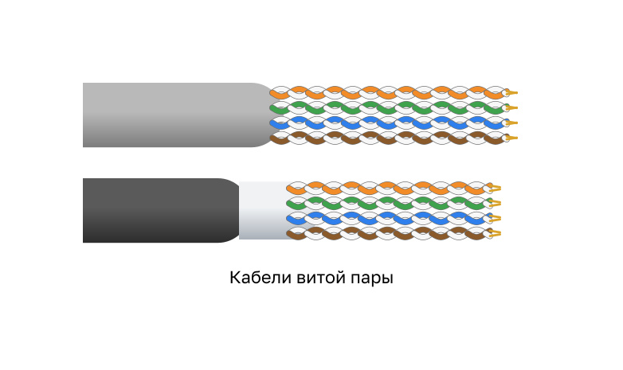
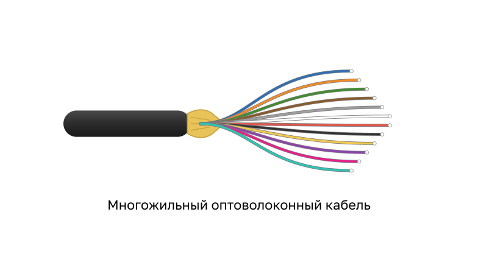
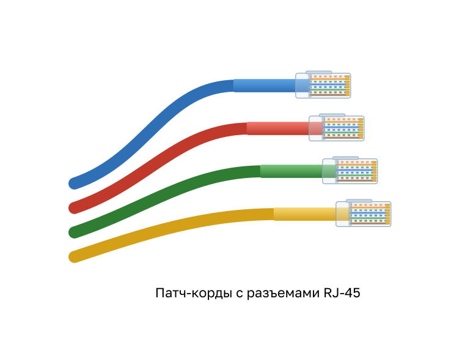
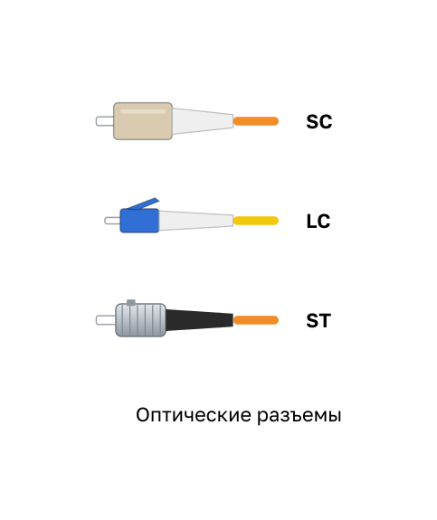
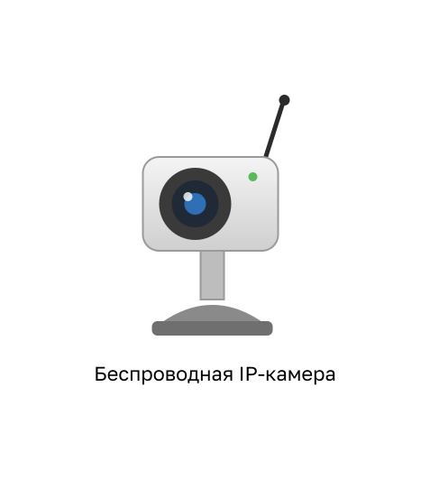

<!-- verified: agorbachev 03.05.2022 -->
<!-- 1.2.1 -->
## Роли узла

Если вы хотите быть частью глобального Интернет-сообщества, ваш компьютер, планшет или смартфон сначала должны быть подключены к сети. Эта сеть должна быть подключена к Интернету. В этом разделе рассматриваются части сети. Посмотрите, сможете ли вы распознать эти компоненты в вашей домашней или школьной сети.

Все компьютеры, подключенные к сети и непосредственно участвующие в сетевом взаимодействии, считаются узлами. Их также называют оконечными устройствами. Некоторые узлы также называются клиентами. Однако сам термин «узлы» относится к устройствам в сети, которым присвоен номер для целей связи. Этот номер идентифицирует узел в определенной сети и называется IP-адресом. IP-адрес определяет узел и сеть, к которой подключен узел.

Серверы — это компьютеры с установленным программным обеспечением, позволяющим предоставлять данные (например, доступ к электронной почте или веб-страницам) другим оконечным устройствам в сети. Для работы каждой службы необходимо отдельное серверное программное обеспечение. Например, для работы веб-служб в сети на узле должно быть установлено ПО веб-сервера. Компьютер с серверным программным обеспечением может одновременно обслуживать одного или несколько клиентов.

Клиенты являются типом узла. Они имеют программное обеспечение для запроса информации у сервера, например через Интернет, и отображения полученной информации.

Примером клиентского программного обеспечения является веб-браузер, например Chrome или FireFox. Кроме того, на одном компьютере можно запускать несколько типов клиентского программного обеспечения. Например, у пользователя есть возможность проверять электронную почту, просматривать веб-страницы, обмениваться мгновенными сообщениями и слушать аудиопоток. В таблице перечислены три распространенных типа серверного программного обеспечения.

| Тип | Описание |
| --- | --- |
| Эл. почта | На сервере электронной почты выполняется серверное ПО электронной почты. Клиенты используют почтовое ПО, такое как Microsoft Outlook, для получения доступа к почте на сервере. |
| Интернет | На веб-сервере запущено серверное ПО. Клиенты используют браузерное программное обеспечение, такое как Windows Internet Explorer, для получения доступа к веб-страницам на сервере. |
| Файл | На файловом сервере в центральном пункте хранятся корпоративные и пользовательские файлы. Клиентские устройства получают доступ к этим файлам с помощью клиентского ПО, такого как Windows Explorer. |

<!-- 1.2.2 -->
## Одноранговые сети

Обычно клиентское и серверное программное обеспечение запускается на разных компьютерах, но эти роли может играть и один компьютер. В небольших корпоративных и домашних сетях многие компьютеры работают и как серверы, и как клиенты. Такие сети называются одноранговыми.

Например, в небольшой одноранговой сети один компьютер предоставляет другим совместный доступ к подключенному к нему принтеру, а другой — к своим файлам.

Преимущества одноранговой сети:

* легкость установки;
* менее запутанно;
* дешевле (поскольку сетевые устройства и выделенные серверы могут не потребоваться);
* можно использовать для простых задач, таких как передача файлов и совместное использование принтеров.

Недостатки одноранговой сети:

* нет централизованного управления;
* есть проблемы с безопасностью;
* не масштабируется;
* все устройства могут быть как клиентами, так и серверами, что может замедлить их работу.

<!-- 1.2.3 -->
## Оконечные устройства

Сетевые устройства, с которыми пользователи знакомы лучше всего — это оконечные устройства. Каждому оконечному устройству в сети назначается адрес, чтобы устройства можно было отличить. Если оконечное устройство инициирует обмен данными, то в качестве получателя сообщения оно использует адрес оконечного устройства назначения.

Оконечное устройство является либо отправителем (источником), либо получателем (адресатом) сообщения, передаваемого по сети.

Например, сообщение от оконечного устройства в одной локальной сети проходит через коммутатор этой сети, затем через маршрутизаторы Интернета, где оно может пойти по одному из альтернативных маршрутов, и через коммутатор второй локальной сети поступает на оконечное устройство назначения. Так данные отправляются из одного оконечного устройства, проходят по сети и поступают на другое оконечное устройство.

<!-- 1.2.4 -->
## Промежуточные устройства

Промежуточные устройства подключают отдельные оконечные устройства к сети. Они могут подключить несколько отдельных сетей и создать объединенную. Такие устройства обеспечивают подключение и прохождение потоков данных по сети.

Для определения пути передачи сообщения промежуточные устройства используют адрес оконечного устройства назначения в сочетании с информацией о связях в сети. Распространенные промежуточные устройства — беспроводной маршрутизатор, коммутатор локальной сети, маршрутизатор, многоуровневый коммутатор и аппаратный межсетевой экран.

Промежуточные сетевые устройства выполняют некоторые из этих функций или все сразу:

* регенерируют и ретранслируют сигналы связи;
* сохраняют информацию о существующих путях в сети и между сетями;
* уведомляют другие устройства об ошибках и сбоях в процессе коммуникации;
* направляют данные по альтернативному маршруту при выходе канала из строя;
* классифицируют и направляют сообщения согласно приоритетам;
* разрешают или запрещают передачу данных в зависимости от настроек безопасности.

**Примечание:** Не показан устаревший концентратор Ethernet. Его также называют многопортовым ретранслятором. Ретрансляторы регенерируют и ретранслируют сигналы связи. Обратите внимание, что все промежуточные устройства выполняют такую функцию.

<!-- 1.2.5 -->
## Средства сетевого подключения

Коммуникация передается по среде передачи данных, предоставляющей собой канал, по которому сообщение передается от источника к адресату.

Современные сети используют в первую очередь три типа сред передачи данных для соединения устройств:

* **Металлические провода в кабелях**  — данные кодируются в электрические импульсы.
* **Оптоволоконный кабель** — данные кодируются в световые импульсы.
* **Беспроводная передача** — данные кодируются посредством модуляции конкретных частот электромагнитных волн.

Чтобы выбрать средство подключения, нужно учесть:

* на какое максимальное расстояние средства подключения способны передавать сигнал;
* в каких условиях будут установлены средства подключения;
* какие объемы данных будут передаваться по этой среде и с какой скоростью;
* какова стоимость средства подключения и его установки.

Примеры сред передачи данных: для медной среды — кабели витой пары и патч-корды с разъемами RJ-45, для оптоволоконной — многожильный оптоволоконный кабель и оптические разъемы SC, LC и ST, для беспроводной связи — радиоканал между беспроводным маршрутизатором и устройством, например беспроводной IP-камерой.

| Медный кабель | Оптоволоконные кабели | Беспроводная связь |
| --- | --- | --- |
|  |  |  |
|  |  |  |
<!-- 1.2.6 -->
<!-- quiz -->
