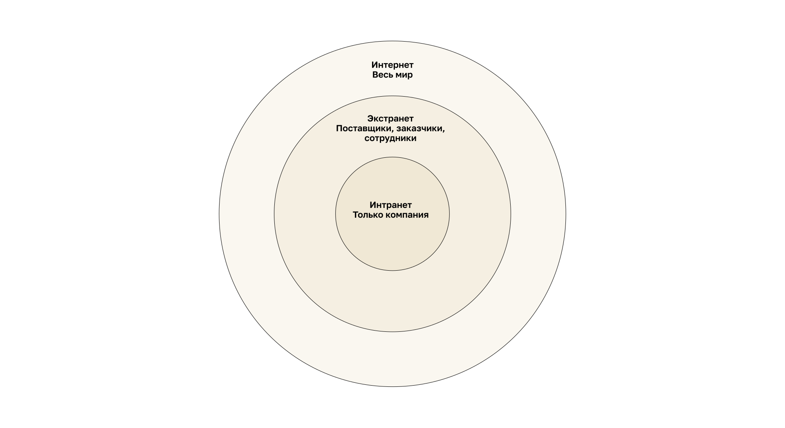

<!-- verified: agorbachev 03.05.2022 -->

<!-- 1.4.1 -->
## Сети различного размера

Теперь, когда вы знакомы с компонентами, составляющими сети, и их представлениями в физических и логических топологиях, пришло время узнать о различных типах сетей.

Сети могут быть любого размера, начиная с простых из двух компьютеров и заканчивая соединяющими миллионы устройств.

Простые домашние сети позволяют обмениваться ресурсами, такими как принтеры, документы, изображения и музыка, между несколькими локальными оконечными устройствами.

Сети малого офиса и домашнего офиса (SOHO) позволяют людям работать из дома или из удаленного офиса. Многие индивидуальные предприниматели используют эти типы сетей для рекламы и продажи продуктов, заказа расходных материалов и общения с клиентами.

На предприятиях и в крупных организациях используются более крупные сети, чтобы сотрудники могли собирать, хранить и получать информацию на сетевых серверах. Такие сети позволяют наладить связь через электронную почту, мгновенный обмен сообщениями, а также с помощью инструментов совместной работы. Многие организации используют подключение своей сети к Интернету для предоставления продуктов и услуг клиентам.

На сегодняшний день Интернет является крупнейшей сетью мира. На самом деле понятие «Интернет» означает «сеть всех сетей». Интернет буквально представляет собой объединение подключенных друг к другу частных и общедоступных сетей.

В небольших корпоративных и домашних сетях многие компьютеры работают и как серверы, и как клиенты. Такие сети называются одноранговыми.

**Небольшие домашние и офисные сети**

Небольшие домашние и офисные сети (SOHO) позволяют подключаться к корпоративной сети или получать доступ к централизованным и совместно используемым ресурсам из дома или удаленного офиса.

**Средние и крупные сети**

Средние и крупные сети, например, используемые корпорациями или образовательными учреждениями, могут связывать множество местоположений с сотнями или тысячами узлов.

**Глобальные сети**

Глобальная электронная сеть Интернет связывает миллионы компьютеров по всему миру.

<!-- 1.4.2 -->
## Локальные и глобальные сети

Сетевые инфраструктуры могут значительно отличаться по следующим критериям:

* площадь покрытия;
* количество подключенных пользователей;
* количество и типы доступных служб;
* область ответственности.

Двумя наиболее распространенными типами сетевых инфраструктур являются локальные (LAN) и глобальные сети (WAN). LAN – это сетевая инфраструктура, которая обеспечивает доступ пользователям и оконечным устройствам в небольшой географической зоне. Обычно локальная сеть используется в подразделении предприятия, дома или объекте малого бизнеса. Глобальная сеть (WAN) — сетевая инфраструктура, предоставляющая доступ к другим сетям на большой территории. Обычно принадлежит большим корпорациям или провайдерам телекоммуникационных услуг и находится под их управлением. Например, локальные сети центрального офиса, филиала и домашнего офиса соединены через глобальную сеть: маршрутизатор каждой из них подключен к глобальной сети и находится на границе LAN и WAN.

**LAN**

Сети LAN — сетевая инфраструктура, которая охватывает небольшую территорию. Особенности LAN:

* связывают оконечные устройства в ограниченной области (например, в доме, школе, офисном здании или комплексе зданий);
* обычно администрируются одной организацией или частным лицом. Административный контроль осуществляется на уровне сети и управляет политикой безопасности и контролем доступа;
* предоставляют высокоскоростной доступ к внутренним оконечным и промежуточным устройствам.

Сеть, обслуживающая квартиру, небольшое здание или небольшой комплекс зданий, считается локальной сетью (LAN). Например, в небольшой локальной сети компьютеры сотрудников, IP-телефон и сервер подключены к одному коммутатору.

**WAN**

Глобальная сеть (WAN) — это сетевая инфраструктура, которая охватывает обширную территорию. Например, глобальная сеть соединяет локальные сети двух филиалов: маршрутизаторы филиалов связаны между собой каналом WAN. Глобальными сетями обычно управляют операторы связи (SP) или Интернет-провайдеры (ISP).

Особенности WAN:

* связывают локальные сети в обширных географических областях (например, города, регионы, страны или континенты);
* управляются различными операторами связи;
* обеспечивают менее скоростные соединения между локальными сетями.

<!-- 1.4.3 -->
## Интернет

Интернет — это объединение взаимосвязанных сетей в мировом масштабе: локальных сетей домов, учебных заведений, больниц, предприятий и государственных учреждений, подключенных друг к другу через глобальные сети.

Локальные сети подключаются друг к другу через глобальные сети, а глобальные сети соединяются между собой. Для этого используются самые разные способы подключения: медные провода, оптоволоконный кабель и беспроводная передача данных.

Интернет не принадлежит какому-либо лицу или группе людей. Обеспечение эффективного общения с помощью такой разнообразной инфраструктуры требует применения последовательных и общепризнанных технологий и стандартов, а также совместной работы многих учреждений, администрирующих сети. Существуют организации, которые были разработаны для поддержки структуры и стандартизации интернет-протоколов и процессов. Эти организации включают в себя Инженерную группу по развитию Интернета (Internet Engineering Task Force, IETF), Корпорацию по присвоению имен и номеров (Internet Corporation for Assigned Names and Numbers, ICANN) и Совет по архитектуре сети Интернет (Internet Architecture Board, IAB), а также многие другие.

<!-- 1.4.4 -->
## Внутренние сети и внешние сети

Есть два других термина, которые похожи на термин Интернет: интранет и экстранет.

Термин «интранет» обозначает частные сети LAN и WAN, принадлежащие конкретной организации. Доступ к Интранету имеется только у членов и сотрудников организации, а также у других лиц с надлежащими полномочиями.

Организация может использовать Экстранет для защищенного и безопасного доступа сотрудников, которые работают в других организациях, но которым необходим доступ к данным компании. Вот несколько примеров Экстранета:

* компания, предоставляющая доступ внешним поставщикам или подрядчикам;
* больница, где используется система записи к врачам, которые имеют возможность назначать дату приема пациентов;
* местное управление образования, предоставляющее школам своего района данные о размере бюджета и кадрах.

Уровни доступа вложены друг в друга: интранет доступен только самой компании, экстранет — также ее поставщикам, заказчикам и сотрудникам других организаций, а Интернет — всему миру.

<!-- 1.4.5 -->
<!-- quiz -->
