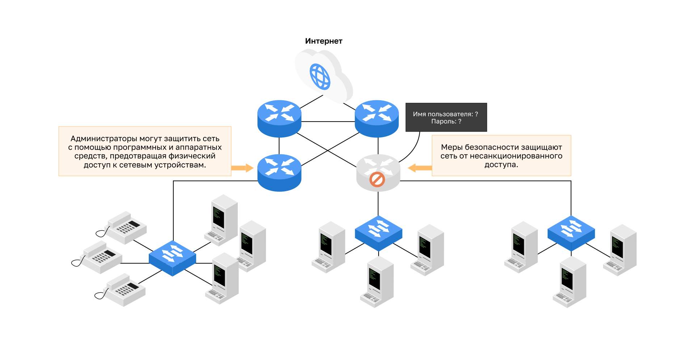

<!-- verified: agorbachev 03.05.2022 -->

<!-- 1.6.1 -->
## Сетевая архитектура

Вы когда-нибудь попадали в ситуацию, когда работаете онлайн, и вдруг «отключается Интернет»? Как вы знаете, в такой момент на самом деле не Интернет вышел из строя, а вы потеряли с ним связь. Это очень расстраивает. Поскольку в мире очень многие полагаются на доступ к сети, чтобы работать и учиться, очень важно, чтобы эта сеть была надежной. В этом контексте надежность означает больше, чем ваше подключение к Интернету. В этом разделе рассматриваются четыре аспекта надежности сети.

Роль сети изменилась. Сеть, используемая только для передачи данных, превратилась в систему, которая соединяет пользователей и устройства, а также передает информацию в конвергентной сетевой среде. Чтобы сеть могла эффективно работать и развиваться в такой среде, необходимо использовать стандартную сетевую архитектуру.

Сети поддерживают широкий спектр приложений и услуг. Они должны работать по различным типам кабелей и устройств, которые составляют физическую инфраструктуру. Термин «сетевая архитектура» в этом контексте относится к технологиям, которые поддерживают инфраструктуру, а также к запрограммированным услугам и правилам или протоколам, которые служат для передачи данных в сети.

По мере развития сетей мы узнали, что существует четыре основных характеристики, которые должны учитывать сетевые архитекторы для удовлетворения ожиданий пользователей:

* устойчивость к сбоям;
* масштабируемость;
* качество обслуживания (QoS);
* безопасность.

<!-- 1.6.2 -->
## Устойчивость к сбоям

Устойчивая к сбоям сеть – это сеть, которая ограничивает количество устройств, затронутых сбоем. Кроме того, она построена так, чтобы быстро восстанавливаться при возникновении отказа. Эти сети используют несколько путей передачи данных от источника к месту назначения. Если один путь недоступен, сообщения направляются по другому пути — после короткого перерыва, нужного сети, чтобы обнаружить отказ и перестроить маршруты. Наличие нескольких путей к месту назначения называется резервированием.

Реализация сети с коммутацией пакетов является одним из способов обеспечить резервирование надежными сетями. При коммутации пакетов трафик делится на пакеты, которые направляются по сети общего доступа. Такое единое сообщение, как электронное письмо или видеопоток, делится на множество блоков данных, называемых пакетами. Каждый пакет содержит информацию об адресе источника и месте назначения сообщения. Маршрутизаторы в сети коммутируют пакеты в зависимости от текущего состояния сети. Это значит, что пакеты данных одного сообщения могут идти к месту назначения различными путями. Например, если один из маршрутизаторов на пути к Интернету выходит из строя, трафик идет к Интернету через другой маршрутизатор по резервному каналу. Такое динамическое изменение маршрута, как правило, мало заметно для пользователя: короткий перерыв при перестройке маршрута может быть заметен в приложениях, чувствительных к потерям, например в голосовой связи и видео в реальном времени.

<!-- 1.6.3 -->
## Масштабируемость

Масштабируемая сеть быстро расширяется для поддержки новых пользователей и приложений. При этом не ухудшается производительность служб, к которым обращаются существующие пользователи. Например, к сети, уже подключенной к Интернету, можно добавить новую локальную сеть, и производительность для существующих пользователей не снизится. Помимо этого, масштабируемость сетей возможна благодаря тому, что проектировщики следуют принятым стандартам и протоколам. Это позволяет поставщикам программного и аппаратного обеспечения сосредоточиться на улучшении продуктов и услуг без необходимости разрабатывать новый набор правил для работы в сети.

<!-- 1.6.4 -->
## Качество обслуживания

Современные сети предъявляют все более высокие требования к качеству обслуживания (QoS). Новые веб-приложения, например, передача голоса и видео в режиме реального времени, задают более высокие требования к качеству предоставляемых услуг. Приходилось ли вам когда-нибудь смотреть видео с постоянными разрывами и паузами? Когда данные, голос и видео идут по одной сети, QoS становится основным механизмом управления перегрузкой: он делит полосу пропускания и буферы между классами трафика и решает, какой пакет передать первым, а какой задержать или отбросить, так что чувствительный к задержкам трафик обслуживается лучше за счет менее важного.

Перегрузка сети возникает, когда спрос на каналы связи превышает возможности сети. Пропускная способность сети измеряется в количестве бит, передаваемых за одну секунду (бит/с). При параллельных попытках передачи информации спрос на каналы связи может превышать возможности сети. Это создает перегрузки сети.

Когда объем трафика превышает возможности доставки по сети, устройства помещают пакеты в очередь в памяти и удерживают их до тех пор, пока не будут доступны ресурсы передачи. Например, один пользователь запрашивает веб-страницу, а другой совершает телефонный звонок по IP (VoIP). Благодаря политике QoS маршрутизатор обрабатывает поток данных и голосовой трафик, отдавая приоритет голосовой связи в случае перегрузки сети: голосу приоритет нужен для плавного и бесперебойного обслуживания, а веб-страницы обычно могут работать с низким приоритетом.

<!-- 1.6.5 -->
## Безопасность сети

Сетевая инфраструктура, сервисы и данные, которые содержатся в устройствах, подключенных к сетям, представляют собой важные личные и корпоративные активы. Существует два типа проблем безопасности сети, которые необходимо учесть: безопасность сетевой инфраструктуры и безопасность информации.

Обеспечение безопасности инфраструктуры сети включает в себя физическую защиту всех устройств, которые необходимы для сетевых подключений, и предотвращение несанкционированного доступа к установленному на них ПО управления. Например, администраторы защищают сеть программными и аппаратными средствами и не допускают посторонних к сетевым устройствам физически, а для доступа к ПО управления маршрутизатором требуются имя пользователя и пароль.

Сетевые администраторы также должны защищать информацию, содержащуюся в пакетах, передаваемых по сети, и информацию, хранящуюся на устройствах, подключенных к сети. Существует три основных требования для достижения безопасности сети:

* **конфиденциальность**  — только указанные и авторизованные получатели могут иметь доступ к данным;
* **целостность**  — гарантия того, что информация не была изменена в процессе передачи от исходного пункта к месту назначения;
* **доступность**  — своевременный и надежный доступ к данным для авторизованных пользователей.

<!-- 1.6.6 -->
<!-- quiz -->
