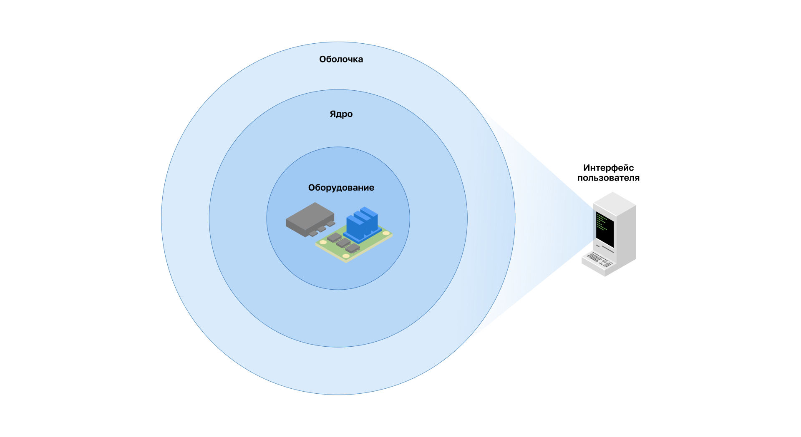
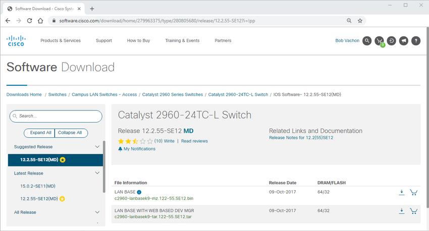
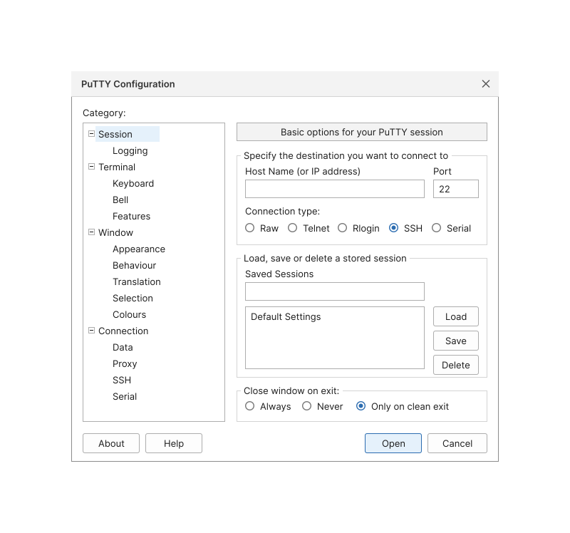

<!-- verified: agorbachev 03.05.2022 -->

<!-- 2.1.1 -->
## Операционные системы

Всем оконечным и сетевым устройствам требуется операционная система (ОС). Часть ОС, которая непосредственно взаимодействует с аппаратным обеспечением компьютера, называется ядром. Часть, которая обеспечивает связь между приложениями и пользователем, называется оболочкой: она окружает ядро, а ядро — оборудование. Пользователь взаимодействует с оболочкой посредством интерфейса командной строки (command-line interface, CLI) или графического интерфейса (graphical user interface, GUI).




* **Оболочка** — пользовательский интерфейс, позволяющий запрашивать определенные задачи с компьютера. Эти запросы могут быть сделаны либо через интерфейс CLI, либо через интерфейс GUI.
* **Ядро** — часть операционной системы, обеспечивающая взаимодействие аппаратных средств и программного обеспечения компьютера, распределение системных ресурсов и т.д.
* **Оборудование** — электронные и иные физические компоненты компьютера.

При использовании CLI происходит непосредственное обращение к системе в текстовом режиме путем ввода команд с клавиатуры в командной строке. Система выполняет команду, часто выводя выходные данные в текстовом формате. Для работы с CLI требуется передавать минимальное количество данных. Однако пользователь должен знать базовую структуру команд для управления системой.

```bash
analyst@secOps ~]$ ls 
Desktop Downloads lab.support.files second_drive
[analyst@secOps ~]$ 
```

<!-- 2.1.2 -->
## Графический интерфейс пользователя

Интерфейс GUI, такой как в ОС Windows, OS X, Apple iOS или Android, позволяет пользователю взаимодействовать с системой при помощи графических значков, меню и окон. GUI более удобен и не требует обширных знаний базовой структуры команд для управления системой. Именно поэтому многие используют GUI.

Однако GUI не всегда предоставляет все те возможности, что доступны при использовании CLI. Кроме того, в GUI часто случаются ошибки, аварийные сбои или попросту неправильная работа. Поэтому для обращения к сетевым устройствам обычно используется CLI. CLI — менее ресурсоемкий интерфейс и работает гораздо устойчивее, чем GUI.

Маршрутизаторы и коммутаторы тоже работают под управлением операционной системы — сетевой ОС. Ее выпускает производитель оборудования, и для разных классов устройств — от коммутаторов доступа до маршрутизаторов операторов связи и коммутаторов центров обработки данных — у него обычно разные линейки ОС. Интерфейс командной строки многих сетевых ОС устроен похоже: режимы работы, синтаксис команд и вид выходных данных, которые изучаются в этом курсе, — общепринятый в отрасли стиль.

**Примечание**: Операционная система на домашних маршрутизаторах обычно называется микропрограммным обеспечением. Самый распространенный способ настройки домашнего маршрутизатора — использование GUI на основе веб-браузера.

<!-- 2.1.3 -->
## Назначение ОС

Сетевые операционные системы аналогичны операционным системам ПК. При помощи GUI пользователь операционной системы ПК может выполнять следующие задачи:

* выбирать различные объекты и запускать программы, используя мышь;
* вводить текст и текстовые команды;
* просматривать выходные данные на экране монитора.

При помощи сетевой операционной системы на базе CLI, такой как ОС коммутатора или маршрутизатора, сетевой специалист может выполнять следующие задачи:

* запускать сетевые программы на базе CLI, используя клавиатуру;
* вводить текст и текстовые команды с клавиатуры;
* просматривать выходные данные на экране монитора.

Каждое сетевое устройство работает под управлением определенной версии ОС. Версия зависит от модели устройства и от нужных функций. Устройство поставляется с ОС и набором функций по умолчанию; более новая версия ОС или расширенный набор функций открывают дополнительные возможности. Доступные для модели версии ОС производитель публикует на своем сайте, откуда образы ОС и загружают.


<!-- /courses/itn-dl/aeecb970-34fa-11eb-ad9a-f74babed41a6/af1ec5f0-34fa-11eb-ad9a-f74babed41a6/assets/2d9ec912-1c25-11ea-81a0-ffc2c49b96bc_md.png>

<!-- 2.1.4 -->
## Способы доступа

Коммутатор будет пересылать трафик по умолчанию, его не нужно явно настраивать для работы. Например, два настроенных узла, подключенных к одному и тому же новому коммутатору, смогут обмениваться данными.

Независимо от поведения нового коммутатора, все коммутаторы должны быть настроены и защищены.

| **Метод** | **Описание** |
| --- | --- |
| **Консоль** | Это физический порт управления, обеспечивающий внеполосный доступ к устройству. Внеполосный доступ осуществляется через выделенный административный канал, который используется исключительно в целях технического обслуживания устройства. Преимущество использования порта консоли состоит в том, что доступ к устройству возможен даже без настройки сетевых сервисов, например, во время начальной настройки сетевого устройства. Для подключения к консоли требуется компьютер с программным обеспечением эмуляции терминала и специальный кабель консоли для подключения к устройству|
| **Протокол Secure Shell (SSH)** | Secure Shell (SSH) — метод, позволяющий удаленно установить защищенное подключение CLI через виртуальный интерфейс по сети. В отличие от консольного подключения для SSH-подключений на устройстве должны быть активны сетевые службы, включая активный интерфейс с настроенным адресом. Большинство версий ОС содержит SSH-сервер и SSH-клиент, который можно использовать для SSH-соединения с другими устройствами|
| **Telnet** | Telnet — это незащищенный протокол, позволяющий удаленно начать сеанс CLI через виртуальный интерфейс по сети. В отличие от SSH, Telnet не обеспечивает безопасного зашифрованного соединения и должен использоваться только в лабораторной среде. Данные для аутентификации пользователя, пароли и команды передаются по сети в виде простого текста. Лучше всего использовать SSH вместо Telnet. ОС включает в себя как сервер Telnet, так и клиент Telnet. |

**Примечание:** Некоторые устройства, такие как маршрутизаторы, также могут поддерживать устаревший вспомогательный порт, который раньше использовался, чтобы удаленно начать сеанс CLI с помощью модема. Аналогично консольному подключению вспомогательный порт обеспечивает внеполосное подключение и не требует сетевых служб, но для входящих вызовов сам порт и модем нужно настроить.

<!-- 2.1.5 -->
## Программы эмуляции терминала

Существует несколько программ эмуляции терминала, используемых для подключения к сетевым устройствам при помощи последовательного подключения через консольный порт, либо посредством подключения по протоколам SSH/Telnet. Эти программы позволяют работать эффективнее за счет регулировки размера окон, изменения размера шрифтов и цветовых схем.

**PuTTY** 



<!--
окно настройки сеанса PuTTY: слева дерево категорий, справа адрес узла и порт 22, тип подключения SSH, сохраненные сеансы, параметр закрытия окна при выходе и кнопки Open и Cancel
-->

<!-- 2.1.6 -->
<!-- quiz -->
