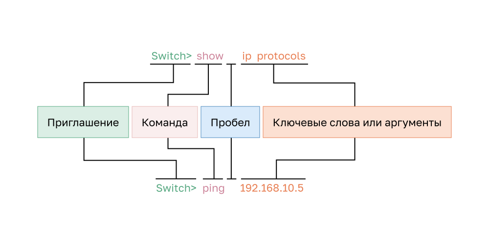

<!-- verified: agorbachev 03.05.2022 -->

<!-- 2.3.1 -->
## Базовая структура команд ОС

В этом разделе рассматривается основная структура команд для ОС. Администратор сети должен знать базовую структуру команд ОС, чтобы иметь возможность использовать интерфейс командной строки для конфигурации устройства.

Сетевые устройства поддерживают множество команд. Каждая команда ОС имеет определенный формат или синтаксис и выполняется только в соответствующем режиме. Общий синтаксис команды таков: после приглашения вводится сама команда, затем через пробел — необходимые ключевые слова или аргументы. Например, в строке `Switch> show ip protocols` после приглашения `Switch>` идет команда **show** и ключевое слово **ip protocols**, а в строке `Switch> ping 192.168.10.5` — команда **ping** и аргумент **192.168.10.5**.




* **Ключевое слово** — это параметр, определенный в операционной системе (например, **ip protocols** в команде **show ip protocols**).
* **Аргумент** — это значение или переменная, определенная пользователем (например, **192.168.10.5** в команде **ping 192.168.10.5**).
После ввода каждой полной команды, включая все ключевые слова и аргументы, нажмите клавишу **Enter**, чтобы отправить эту команду в командный процессор.

<!-- 2.3.2 -->
## Проверка синтаксиса команд ОС

Для команды могут требоваться один или несколько аргументов. Чтобы определить, какие ключевые слова и аргументы нужны для команды, обратитесь к синтаксису команд. Синтаксис обеспечивает шаблон или формат, который необходимо использовать при вводе команды.

Как показано в таблице, полужирным шрифтом выделены команды и ключевые слова, которые вводятся как есть. Курсивом выделены аргументы, для которых пользователь указывает значение.

| **Условное обозначение** | **Описание** |
| --- | --- |
| **полужирный** | Вводимые команды и ключевые слова отображаются полужирным шрифтом|
| *курсив* | Курсивом отображаются аргументы, для которых нужно указать значения|
| **[**x**]** | В квадратных скобках отображаются дополнительные элементы (ключевое слово или аргумент)|
| **{x}** | В фигурных скобках отображаются обязательные элементы (ключевое слово или аргумент)|
| **[x {y \| z}]** | Фигурные скобки и вертикальные линии в квадратных скобках означают, что необходимо выбрать дополнительный элемент. Пробелы используются для четкого разграничения частей команды|

Например, синтаксис для использования команды **description** следующий **description** _string._ Аргумент является значением _string_, предоставленным пользователем. Команда **description** обычно используется для определения назначения интерфейса. Например, команда **description Connects to the main headquarter office switch** (подключение к коммутатору головного офиса) определяет, где находится другое устройство на другой стороне соединения.

Ниже представлены примеры условных обозначений для документирования и использования команд ОС:

* **ping** IP-address — команда **ping**, а пользовательский аргумент — это IP-адрес целевого устройства. Например, **ping 10.10.10.5**.
* **traceroute** IP-address — команда traceroute, а определяемый пользователем аргумент является IP-адресом целевого устройства. Например, **traceroute 192.168.254.254**.
Если команда сложная с несколькими аргументами, вы можете увидеть ее в следующем виде:

```
 Switch(config-if)# switchport port-security aging { static | time time | type {absolute | inactivity}} 
```

Команда обычно сопровождается подробным описанием ее и каждого ее аргумента.

Главным источником информации о конкретных командах является справочник команд ОС.

<!-- 2.3.3 -->
## Компоненты справки ОС

В сетевой операционной системе предусмотрены две формы предоставления справочной информации: контекстная справка и проверка синтаксиса команд.

Контекстная справка позволяет быстро найти ответы на следующие вопросы:

* Какие команды доступны в каждом командном режиме?
* Какие команды начинаются с определенных символов или группы символов?
* Какие аргументы и ключевые слова доступны для определенных команд?

Для доступа к контекстной справке просто введите вопросительный знак **?** в командной строке CLI.

Проверка синтаксиса команды подтверждает, что пользователь ввел допустимую команду. Командный процессор анализирует введенную команду слева направо. Если процессор распознает команду, то выполняется требуемое действие и интерфейс CLI возвращается к соответствующей командной строке. Если процессор не распознает введенную команду, он отображает возможные ошибки.

<!-- 2.3.4 -->
## Контекстная справка и проверка синтаксиса команд

1. Вопросительный знак **?** в командной строке выводит список команд, доступных в текущем режиме. В пользовательском режиме EXEC (**S1>**), в привилегированном (**S1#**) и в режиме глобальной конфигурации (**S1(config)#**) списки разные.
2. Начало команды и **?** без пробела, например **in?**, выводят команды, которые начинаются с этих символов (**interface**). Набранное остается в строке, и команду можно дописать.
3. Команда, пробел и **?**, например **interface ?**, выводят ключевые слова и аргументы, которые можно ввести дальше (типы интерфейсов).
4. Проверка синтаксиса разбирает команду слева направо. Для **interface 33** маркер **^** стоит под символом, с которого команда не распознана: `% Invalid input detected at '^' marker.`
5. Одной буквы **i** недостаточно: с нее начинается несколько команд режима глобальной конфигурации, например **interface** и **ip**. Сообщение: `% Ambiguous command:  "i"`.
6. Команда **interface** без ключевых слов и аргументов неполная: `% Incomplete command.` Команда **interface ?** подсказывает, что ввести дальше.


<!-- 2.3.5 -->
## Горячие клавиши и клавиши быстрого вызова

Интерфейс командной строки ОС предусматривает горячие клавиши и клавиши быстрого вызова, которые упрощают процесс настройки, мониторинга, поиска и устранения неполадок.

Команды и ключевые слова можно сокращать до минимального количества символов, которые однозначно идентифицируют выбранную команду или слово. Например, команду **configure** можно сократить до **conf**, поскольку **configure** — это единственная команда, которая начинается с символов **conf**. Сокращение **con** использовать нельзя, так как с символов **con** начинается несколько команд. Ключевые слова также можно сокращать.

В таблице перечислены сочетания клавиш для улучшения редактирования в командной строке.

| **Сочетание клавиш** | **Описание** |
| --- | --- |
| **Tab** | Завершает частично введенную команду |
| **Backspace** | Удаляет один символ слева от курсора |
| **Ctrl-D** | Удаляет символ, на котором стоит курсор |
| **Ctrl-K** | Удаляет все символы от курсора до конца командной строки |
| **Esc D** | Удаляет все символы от курсора до конца слова |
| **Ctrl+U** или **Ctrl+x** | Удаляет все символы от курсора до начала командной строки |
| **Ctrl-W** | Удаляет слово слева от курсора |
| **Ctrl-A** | Перемещает курсор в начало строки |
| **Клавиша со стрелкой влево** или **Ctrl+B** | Перемещает курсор на один символ влево |
| **Esc B** | Перемещает курсор на одно слово назад влево |
| **Esc F** | Перемещает курсор на одно слово вперед вправо |
| **Клавиша со стрелкой вправо** или **Ctrl+F** | Перемещает курсор на один символ вправо |
| **Ctrl-E** | Перемещает курсор в конец командной строки |
| **Клавиша со стрелкой вверх** или **Ctrl+P** | Вызывает команды в буфере истории, начиная с самых последних команд |
| **Ctrl+R** или **Ctrl+I** или **Ctrl+L** | Заново открывает командную строку системы после получения сообщения из консоли |

**Примечание:** Хотя клавиша **Delete** обычно удаляет символ справа от приглашения, структура команд ОС не распознает ее.

Когда вывод команды создает больше текста, чем может отображаться в окне терминала, ОС отобразит  приглашение **“--More--”**. В следующей таблице описаны сочетания клавиш, которые могут использоваться в работе при отображении этого запроса.

| **Сочетание клавиш** | **Описание** |
| --- | --- |
| Клавиша **Enter** | Показывает следующую строку |
| **Пробел** | Показывает следующий экран |
| Любая друга клавиша | Закрывает строку и возвращает пользователя в привилегированный режим EXEC |


В этой таблице перечислены команды, используемые для выхода из режима.

| **Сочетание клавиш** | **Описание** |
| --- | --- |
| **Ctrl-C** | Это сочетание клавиш останавливает любой запущенный режим конфигурации и выполняет возврат к привилегированному режиму EXEC. При работе в режиме настройки возвращает обратно в командную строку |
| **Ctrl-Z** | Это сочетание клавиш останавливает любой запущенный режим конфигурации и выполняет возврат к привилегированному режиму EXEC |
| **Ctrl-Shift-6** | Универсальная последовательность прерывания, используемая для прерывания поиска DNS записи, трассировки маршрута, ping и т.д. |

<!-- 2.3.6 -->
## Горячие клавиши и сокращения команд

1. **Tab** завершает частично введенную команду: в приглашении **S1>** набрано **en**, после **Tab** в строке стоит **enable**.
2. Сокращение **c** использовать нельзя: с этих символов начинается несколько команд. **Tab** ничего не дописывает, а **c?** показывает эти команды, например **clear**, **clock**, **configure** и **copy**. После **conf** клавиша **Tab** дописывает **configure**, потому что это единственная команда, которая начинается с этих символов.
3. Команды и ключевые слова сокращают до минимума символов, однозначно идентифицирующих команду или слово: **int f 0/1** выполняется как **interface fastethernet 0/1**, и появляется приглашение **S1(config-if)#**.
4. **Ctrl+A** перемещает курсор в начало строки, **Ctrl+E** — в конец командной строки. Строка при этом не меняется, и **Enter** выполняет ее целиком.
5. Стрелка вверх вызывает команды из буфера истории, начиная с самых последних: первое нажатие возвращает **interface fastethernet 0/2**, второе — **int f 0/1**.
6. **Ctrl+C** выходит из режима конфигурации в привилегированный режим EXEC: из **S1(config-if)#** в **S1#**. **Ctrl+Z** делает то же самое из **S1(config)#**.
7. **Ctrl+Shift+6** — универсальная последовательность прерывания: она останавливает **ping** к узлу, который не отвечает, и возвращает приглашение **S1#**.

Горячие клавиши и клавиши быстрого вызова упрощают настройку, мониторинг, поиск и устранение неполадок.


