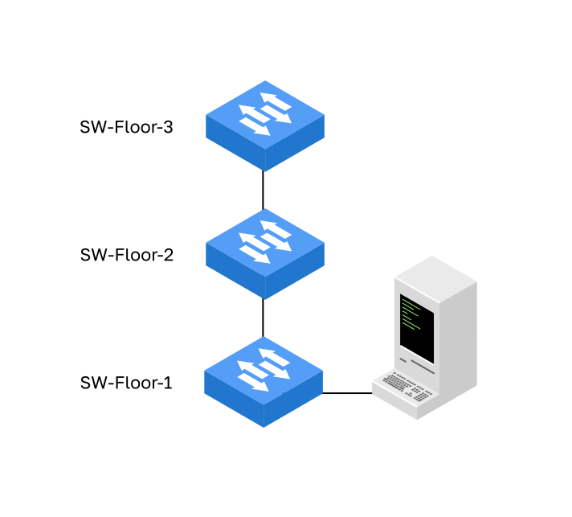

<!-- verified: agorbachev 03.05.2022 -->

<!-- 2.4.1 -->
## Имена устройств

Вы многое узнали об ОС, навигации по ОС и структуре команд. Теперь вы готовы к настройке устройств. Первая задача конфигурации на любом устройстве — дать ему уникальное имя устройства или имя узла. Всем устройствам присваивается имя по умолчанию. Например, в ОС коммутатора имя по умолчанию — "Switch."

Если у всех устройств оставить имена по умолчанию, будет сложно идентифицировать конкретное устройство. Например, как бы вы узнали, что вы подключены к нужному устройству при удаленном доступе к нему, используя SSH? Имя узла подтверждает, что вы подключены к нужному устройству.

Имя по умолчанию должно быть изменено на более описательное. Если выбрать имена со смыслом, то запоминать, документировать и идентифицировать сетевые устройства будет легче. Вот несколько важных рекомендаций по выбору имени узла:

* начинать с буквы;
* не ставить пробелы;
* оканчивать на букву или цифру;
* включать только буквы, цифры и тире;
* составлять не более чем из 63 символов.

Организация должна выработать общее правило об именах устройств, которое позволяет легко и интуитивно идентифицировать конкретное устройство. В именах устройств регистр букв не значим: ОС может показать имя так, как его ввели, но полагаться на сохранение регистра нельзя. Например, в сети есть три коммутатора, расположенные на трех разных этажах и связанные друг с другом по сети. В соглашении об именовании учитывается местоположение и назначение каждого устройства. В сетевой документации выбор этих имен необходимо объяснить, чтобы можно было назначить дополнительным устройствам соответствующие имена.




При использовании имен сетевые устройства легко идентифицировать для последующей настройки. Например, коммутатор на первом этаже называется Sw-Floor-1, на втором — Sw-Floor-2, на третьем — Sw-Floor-3, а компьютер пользователя подключен к коммутатору Sw-Floor-1.

После определения соглашения об именовании нужно присвоить устройствам имена с помощью CLI. Как показано в примере, из привилегированного режима EXEC перейдите в режим глобальной конфигурации с помощью команды **configure terminal**. Обратите внимание на изменение в диалоге командной строки.

```
Switch# configure terminal
Switch(config)# hostname Sw-Floor-1
Sw-Floor-1(config)#
```

В режиме глобальной конфигурации введите команду **hostname**, а затем имя коммутатора и нажмите клавишу **Enter**. Обратите внимание на изменение имени в диалоге командной строки.

**Примечание**: Чтобы удалить настроенное имя узла и вернуть стандартный диалог командной строки для коммутатора, используйте команду глобальной конфигурации **no hostname**.

Каждый раз, когда добавляется или изменяется устройство, должна обновляться документация. В этой документации устройствам должно быть присвоено местоположение, назначение и адрес.

<!-- 2.4.2 -->
## Правила выбора паролей

Использование слабых или легко угадываемых паролей по-прежнему является самой большой проблемой безопасности организаций. Для сетевых устройств, включая домашние беспроводные маршрутизаторы, всегда необходимо задавать пароли, чтобы ограничить административный доступ.

В ОС можно настроить пароли иерархических режимов, чтобы предоставлять разные права доступа к сетевому устройству.

Все сетевые устройства должны ограничивать административный доступ, защищая привилегированный доступ EXEC, пользовательский EXEC и удаленный доступ Telnet с помощью паролей. Кроме того, должны быть зашифрованы все пароли и настроены уведомления о том, что лишь авторизованным пользователям можно получить доступ к устройству.

Используйте надежные пароли, которые сложно подобрать. При выборе паролей необходимо учитывать некоторые ключевые моменты:

* использовать пароли длиной не менее 15 символов: надежность пароля определяет прежде всего длина;
* не считать пароль надежным только потому, что в нем смешаны буквы разного регистра, цифры и специальные символы: длина важнее состава;
* не использовать последовательности символов вроде 1234abcd, по которым пароль легко предсказать;
* не использовать одинаковый пароль для всех устройств;
* не использовать часто употребляющиеся слова, поскольку их легко подобрать.

Используйте Интернет, чтобы найти генератор паролей. Многие из них позволят вам установить длину, набор символов и другие параметры.

**Примечание.** В большинстве лабораторных работ этого курса используются простые пароли, такие как **netlab**. Такие пароли ненадежны и их легко подобрать, поэтому использовать их в рабочей среде не рекомендуется. Мы используем эти пароли лишь для удобства работы в учебной аудитории или для демонстрации примеров.

<!-- 2.4.3 -->
## Настройка паролей

При первоначальном подключении к устройству вы находитесь в пользовательском режиме EXEC. По умолчанию вход в него с консоли пароля не требует: его защищают паролем консольной линии вместе с командой **login**.

Для обеспечения доступа пользователя в режиме EXEC введите режим конфигурации консоли линии с помощью команды глобальной конфигурации **line console 0**, как показано в примере. Ноль используется для обозначения первого (а в большинстве случаев и единственного) интерфейса консоли. Затем задайте пароль пользовательского режима EXEC с помощью команды **password**. Наконец, включите проверку пароля при входе на линию с помощью команды **login**: без нее вход с консоли идет без пароля.

```
Sw-Floor-1# configure terminal 
Sw-Floor-1(config)# line console 0 
Sw-Floor-1(config-line)# password netlab 
Sw-Floor-1(config-line)# login
Sw-Floor-1(config-line)# end
Sw-Floor-1#
```

Теперь для доступа к пользовательскому режиму EXEC с консоли будет необходим пароль.

Чтобы иметь доступ администратора ко всем командам ОС, включая настройку устройства, необходимо получить привилегированный доступ режима EXEC. Это самый важный метод, поскольку он обеспечивает полный доступ к устройству.

Для защиты доступа к привилегированному режиму EXEC используйте команду глобальной конфигурации **enable secret**.

```
Sw-Floor-1# configure terminal
Sw-Floor-1(config)# enable secret netlab
Sw-Floor-1(config)# exit
Sw-Floor-1#
```

Линии виртуального терминала (VTY) обеспечивают удаленный доступ к устройству через Telnet или SSH. Обычно ОС коммутатора поддерживает до 16 линий VTY, пронумерованных от 0 до 15.

Чтобы защитить  VTY, войдите в режим line VTY, используя команду глобальной конфигурации **line vty 0 15**. Затем задайте пароль VTY с помощью команды **password**. Наконец, включите проверку пароля при входе на линии VTY с помощью команды **login**.

Пример защиты линий VTY на коммутаторе приведен ниже.

```
Sw-Floor-1# configure terminal
Sw-Floor-1(config)# line vty 0 15 
Sw-Floor-1(config-line)# password netlab 
Sw-Floor-1(config-line)# login 
Sw-Floor-1(config-line)# end
Sw-Floor-1#
```

<!-- 2.4.4 -->
## Шифрование паролей

Файлы конфигурации **startup-config** и **running-config** отображают большинство паролей в виде простого текста. Это создает угрозу безопасности, поскольку при наличии доступа к этим файлам любой пользователь может увидеть пароли.

Чтобы зашифровать все пароли открытого текста, используйте команду глобальной конфигурации **service password-encryption**, как показано в примере.

```
Sw-Floor-1# configure terminal
Sw-Floor-1(config)# service password-encryption 
Sw-Floor-1(config)#
```

Команда применяет слабый алгоритм шифрования ко всем незашифрованным паролям. Шифрование применяется только к паролям в файле конфигурации, но не к паролям, которые отправлены по сети. Эта команда не позволяет неавторизованным пользователям прочитать пароли в файле конфигурации.

С помощью команды **show running-config** убедитесь, что пароли зашифрованы.

```
Sw-Floor-1(config)# end
Sw-Floor-1# show running-config 
!
!
line con 0
 password 7 09424B1D150415 
login
!
line vty 0 4
password 7 030A5E1F0A0E23
login
!

end 
```

<!-- 2.4.5 -->
## Баннерные сообщения

Хотя пароли защищают сеть от несанкционированного доступа, необходимо использовать уведомления о том, что лишь авторизованным пользователям можно получить доступ к устройству. Для этого нужно добавить баннер во выходные данные устройства. Баннеры могут стать важной частью судебного процесса, если пользователя обвинят в несанкционированном доступе. Отдельные законодательства не разрешают возбуждать судебные дела против пользователей или даже просто следить за их действиями без предупреждения.

Чтобы создать баннерное сообщение дня на сетевом устройстве, используйте команду глобальной конфигурации **banner motd #** _the message of the day_ **#**. Символ «**#**» в синтаксисе команды называется разделителем. Он вводится до и после сообщения. Разделителем может быть любой символ, которого нет в самом сообщении. Поэтому часто используются такие символы, как «**#**». После выполнения команды баннер будет отображаться при всех последующих попытках доступа к устройству, пока не будет удален.

В следующем примере показаны шаги по настройке баннера на **Sw-Floor-1**.

```
Sw-Floor-1# configure terminal
Sw-Floor-1(config)# banner motd #Authorized Access Only# 
```

<!-- 2.4.6 -->
## Безопасный административный доступ к коммутатору

1. В режиме глобальной конфигурации коммутатора S1 команды **line console 0**, **password netlab** и **login** задают пароль консоли: теперь для доступа к пользовательскому режиму EXEC с консоли нужен пароль.
2. **enable secret netlab** защищает доступ к привилегированному режиму EXEC.
3. После выхода из консоли (**exit**) коммутатор при входе спрашивает пароль (**User Access Verification**, **Password:**), а команда **enable** — пароль привилегированного режима EXEC. Пароль при вводе не отображается.
4. **line vty 0 15**, **password netlab** и **login** задают пароль всем 16 линиям VTY, через которые идет удаленный доступ по Telnet или SSH.
5. **show running-config** выводит конфигурацию страницами, **Пробел** показывает следующую. Вместо пароля **enable secret** в конфигурации хранится его хеш (**enable secret 5 …**), а пароли консоли и VTY видны открытым текстом (**password netlab**). Диапазон **0 15** ОС хранит как две группы линий: **line vty 0 4** и **line vty 5 15**.
6. **service password-encryption** шифрует все пароли открытого текста: в **show running-config** у консоли и линий VTY теперь стоит **password 7 …**.
7. **banner motd #Authorized Access Only#** задает баннер: при следующем входе строка **Authorized Access Only** выводится перед запросом пароля.

Пароли консоли, привилегированного режима EXEC и VTY и их шифрование ограничивают административный доступ к устройству, а баннер предупреждает, что доступ разрешен только авторизованным пользователям.


<!-- 2.4.7 -->
<!-- syntax -->
<!-- 2.4.8 -->
<!-- quiz -->
