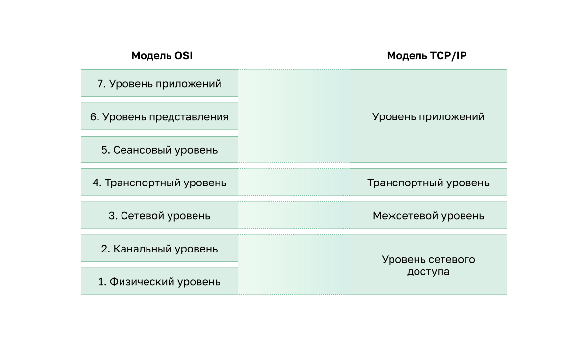

<!-- verified: agorbachev 03.05.2022 -->

<!-- 3.5.1 -->
## Преимущества использования многоуровневой модели

На самом деле вы не можете проследить, как пакеты перемещаются по сети, так же, как если бы вы следили за тем, как компоненты автомобиля собираются вместе на конвейере. В таких ситуациях может помочь модель.

Сложные понятия, такие как **функционирование сети**, трудно объяснить и понять. По этой причине многоуровневая модель используется для модуляции операций сети в управляемые уровни.

Многоуровневая модель для описания сетевых протоколов и операций обеспечивает следующие преимущества:

- упрощает разработку протоколов, поскольку протоколы, работающие на определенном уровне, определяют формат обрабатываемых данных и интерфейс верхних и нижних уровней;
- стимулирует конкуренцию, так как продукты разных поставщиков могут взаимодействовать друг с другом;
- предотвращают влияние изменений технологий или функций одного уровня на другие уровни (верхние и нижние);
- общий язык для описания функций сетевого взаимодействия.

Модель — только представление работы сети; сама по себе она не является сетью. Для описания сетевых операций используются **две многоуровневые модели**:

- эталонная модель взаимодействия открытых систем (OSI);
- эталонная модель TCP/IP.

<!-- 3.5.2 -->
## Эталонная модель OSI

**Модель OSI** определяет широкий список функций и сервисов, реализуемых на каждом уровне. **Эталонная модель** обеспечивает единообразное применение всех сетевых протоколов и сервисов, описывая то, что необходимо сделать на определенном уровне, но не предписывая конкретные способы выполнения.

Кроме того, она описывает взаимодействие каждого уровня с вышестоящими и нижестоящими уровнями. Рассматриваемые в рамках этого курса протоколы TCP/IP соотносятся как с моделью OSI, так и с моделью TCP/IP. В таблице приведены подробные сведения о каждом уровне модели. Функциональные возможности каждого уровня и связь между ними станут более понятны по мере подробного рассмотрения протоколов в этом курсе.

| **Уровни модели OSI** | **Описание** |
| --- | --- |
| **7 – Уровень приложений** | Содержит протоколы для обмена данными между процессами |
| **6 – Уровень представления** | Обеспечивает общее представление данных, передаваемых между службами уровня приложений |
| **5 – Сеансовый уровень** | Предоставляет услуги уровню представления для организации его диалога и управления обменом данными |
| **4 – Транспортный уровень** | Определяет службы для сегментирования, передачи и повторной сборки данных для индивидуальной связи между оконечными устройствами |
| **3 – Сетевой уровень** | Предоставляет функции для обмена отдельными частями данных по сети между указанными оконечными устройствами |
| **2 – Канальный уровень** | Протоколы канального уровня описывают способы обмена кадрами данных при обмене данными между устройствами по общей среде передачи данных |
| **1 – Физический уровень** | Протоколы физического уровня описывают механические, электрические, функциональные и процедурные средства для активации, поддержания и деактивации физических соединений для передачи бит к и от сетевого устройства |

**Примечание.** Если уровни модели TCP/IP обозначаются только по названию, то 7 уровней модели OSI часто обозначаются по номеру. Например, физический уровень упоминается как уровень 1 модели OSI, канальный уровень – уровень 2 и так далее.

<!-- 3.5.3 -->
## Модель протоколов TCP/IP

Протокольная модель сетевого взаимодействия TCP/IP была создана в начале 70-х годов и иногда называется моделью сети Интернет. Протокольная модель соответствует структуре определенного набора протоколов. TCP/IP является протокольной моделью, поскольку в ней описываются функции, которые выполняются на каждом уровне протоколов, входящих в набор протоколов TCP/IP. TCP/IP также используется в качестве эталонной модели. В таблице приведены сведения о каждом уровне модели TCP/IP.

| **Уровни модели TCP/IP** | **Описание** |
| --- | --- |
| **Уровень приложений** | Представляет данные пользователю, а также обеспечивает кодирование и управление диалогом (сеансом) между приложениями |
| **Транспортный уровень** | Поддерживает сквозную связь между приложениями на узлах |
| **Межсетевой уровень** | Определяет наилучший путь через сеть и доставляет пакеты от узла-источника к узлу назначения через разные сети |
| **Уровень сетевого доступа** | Управляет устройствами и средcтвами подключения, формирующими сеть |

Стандарт протоколов TCP/IP рассматривается на общедоступном форуме и определяется в общедоступных документах RFC. Предложение сетевых инженеров сначала публикуется как черновик (Internet-Draft) для открытого обсуждения в IETF, и лишь принятый документ выходит как RFC; не всякий RFC — стандарт.

<!-- 3.5.4 -->
## Сравнение моделей OSI и TCP/IP

Набор протоколов TCP/IP может быть описан с точки зрения эталонной модели OSI. В модели OSI уровень сетевого доступа и уровень приложений модели TCP/IP дополнительно подразделяются для описания отдельных функций, которые реализуются на этих уровнях.

На уровне сетевого доступа набор протоколов TCP/IP не определяет список правил, используемых для передачи по физическому средству подключения. Он описывает только передачу с межсетевого уровня физическим сетевым протоколам. Уровни 1 и 2 модели OSI описывают процедуры доступа к средствам подключения и физическим средствам отправки данных по сети.

Основные сходства касаются транспортного и сетевого (в TCP/IP — межсетевого) уровней. Однако эти две модели по разному работают с вышестоящими и нижестоящими уровнями.

* **Уровень 3** модели OSI, или **сетевой уровень**, соответствует межсетевому уровню модели TCP/IP. Этот уровень описывает протоколы, определяющие пути передачи данных в сети.
* **Уровень 4** модели OSI, или **транспортный уровень**, соответствует транспортному уровню модели TCP/IP. Этот уровень описывает общие сервисы и функции, которые обеспечивают упорядоченную и надежную доставку данных от источника до места назначения.
* **Уровень приложений TCP/IP** включает в себя ряд протоколов, которые поддерживают определенные функции для работы разнообразных приложений конечных пользователей. **Уровни 5, 6 и 7** модели OSI используются в качестве эталонов для разработчиков и поставщиков прикладного программного обеспечения для создания приложений, работающих в сетях.
* **Обе модели (TCP/IP и OSI)** широко применяются в отношении протоколов различных уровней. Так как модель OSI разделяет канальный и физический уровни, именно она используется для этих уровней.

