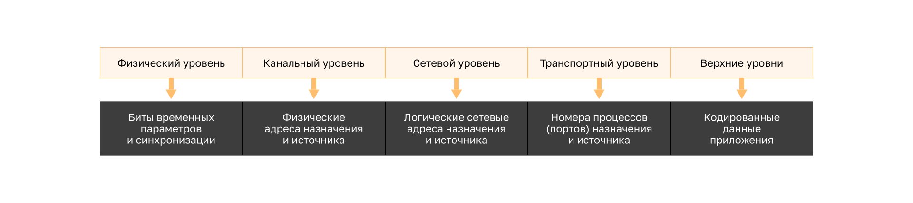

<!-- verified: agorbachev 03.05.2022 -->

<!-- 3.7.1 -->
## Адреса

Как вы только что узнали, необходимо сегментировать сообщения в сети. Но эти сегментированные сообщения никуда не пойдут, если они не будут должным образом адресованы. В этом разделе содержится обзор сетевых адресов.

Сетевой и канальный уровни отвечают за доставку данных с устройства источника на устройство назначения. Протоколы на обоих уровнях содержат адреса источника и места назначения, но эти адреса служат разным целям. Свои сведения для доставки есть на каждом уровне: на физическом это биты временных параметров и синхронизации, на канальном — физические адреса назначения и источника, на сетевом — логические сетевые адреса назначения и источника, на транспортном — номера процессов (портов) назначения и источника, а верхние уровни передают закодированные данные приложения.

* **Адрес источника и места назначения сетевого уровня** необходим для доставки IP-пакета от источника к месту назначения в той же или в удаленной сети.
* **Адрес источника и места назначения канального уровня** необходим для доставки кадра канала данных от одной сетевой интерфейсной платы (NIC) к другой в той же сети.

<!-- 3.7.2 -->
## IP-адрес (логический адрес третьего уровня)

**IP-адрес** — это логический адрес сетевого уровня, необходимый для доставки IP-пакета от источника к месту назначения.

Например, исходный источник PC1 с IP-адресом 192.168.1.110 отправляет IP-пакет конечному пункту назначения — веб-серверу с IP-адресом 172.16.1.99. Пакет проходит через два маршрутизатора, и на всем пути в его заголовке указаны IP-адрес источника 192.168.1.110 и IP-адрес назначения 172.16.1.99.

IP-пакет содержит два IP-адреса.

* **IP-адрес источника** — IP-адрес устройства-отправителя, изначального источника пакета.
* **IP-адрес назначения** — IP-адрес устройства-получателя, конечного места назначения пакета.

**Адреса сетевого уровня** (IP-адреса) представляют собой сетевые адреса источника и места назначения. Это верно, независимо от того, находятся ли источник и адресат в одной и той же IP-сети или в разных.

IP-адрес состоит из двух частей.

* **Сетевая часть IP-адреса** — левая часть адреса, которая указывает на его принадлежность к определенной сети. Все устройства в одной сети будут иметь одинаковую сетевую часть адреса.
* **Узловая часть** — оставшаяся часть адреса, которая идентифицирует конкретное устройство в сети. Узловая часть уникальна для каждого устройства в сети.

**Примечание.** Маска подсети (IPv4) или длина префикса (IPv6) используется для отделения сетевой части IP-адреса от части узла.

<!-- 3.7.3 -->
## Устройства в одной сети

В данном примере есть клиентский компьютер (PC1), который взаимодействует с файловым сервером (FTP server), находящимся в той же IP-сети.

* **IPv4-адрес источника** — IPv4-адрес устройства-отправителя, клиентского компьютера PC1: 192.168.1.110.
* **IPv4-адрес назначения** — IPv4-адрес устройства-получателя, FTP server: 192.168.1.9.

Сетевая часть IPv4-адреса источника и IPv4-адреса назначения одинакова — 192.168.1, а узловые части различаются (110 и 9). Следовательно, источник и пункт назначения находятся в одной сети.

<!-- 3.7.4 -->
## Роль адресов канального уровня: одна IP-сеть

Если отправитель и получатель IP-пакета находятся в одной и той же сети, кадр канала данных отправляется напрямую принимающему устройству. В сети Ethernet адреса каналов передачи данных известны как адреса управления доступом к среде (MAC) Ethernet.

MAC-адреса физически присвоены сетевой интерфейсной плате Ethernet.

* **MAC-адрес источника** — это адрес канального уровня, или MAC-адрес Ethernet устройства, отправляющего кадр канала данных с инкапсулированным IP-пакетом. MAC-адрес сетевой интерфейсной платы Ethernet PC1: AA-AA-AA-AA-AA-AA в шестнадцатиричном представлении.
* **MAC-адреса назначения** — это адрес канала передачи данных принимающего устройства, когда принимающее устройство находится в той же сети, что и передающее устройство. В этом примере MAC-адрес назначения — это MAC-адрес FTP-сервера: CC-CC-CC-CC-CC-CC в шестнадцатиричном представлении.

Теперь кадр с инкапсулированным IP-пакетом может быть передан напрямую с PC1 на FTP server.

<!-- 3.7.5 -->
## Устройства в удаленной сети

Какова роль адреса сетевого уровня и адреса канального уровня при взаимодействии устройства с другим устройством в удаленной сети? В данном примере есть клиентский компьютер (PC1), который взаимодействует с сервером (Web Server), находящимся в другой IP-сети.

<!-- 3.7.6 -->
## Роль адресов сетевого уровня

Если отправитель и получатель пакета находятся в разных сетях, IP-адреса источника и места назначения будут представлять узлы в разных сетях. На это будет указывать сетевая часть IP-адреса узла назначения.

* **IPv4-адрес источника** — IPv4-адрес устройства-отправителя, клиентского компьютера PC1: 192.168.1.110.
* **IPv4-адрес назначения** — IPv4-адрес устройства-получателя, Web Server: 172.16.1.99.

Сетевая часть IPv4-адреса источника (192.168.1) и IPv4-адреса назначения (172.16.1) различается, поэтому источник и место назначения находятся в разных сетях.

<!-- 3.7.7 -->
## Роль адресов канального уровня: разные IP-сети

Если отправитель и получатель IP-пакета находятся в разных сетях, кадр канала данных Ethernet не может быть отправлен напрямую к узлу назначения, поскольку он недоступен в сети отправителя. Кадр Ethernet нужно выслать на другое устройство: маршрутизатор или шлюз по умолчанию. В нашем примере шлюз по умолчанию — R1. R1 имеет адрес канала данных Ethernet в той же сети, что и PC1. Это позволяет PC1 получить прямой доступ к маршрутизатору.

* **MAC-адрес источника** — MAC-адрес Ethernet отправляющего устройства, PC1. MAC-адрес интерфейса Ethernet на PC1 — AA-AA-AA-AA-AA-AA.
* **MAC-адрес места назначения** — устройство-отправитель использует MAC-адрес Ethernet шлюза по умолчанию или маршрутизатора, если получающее и передающее устройства находятся в разных сетях. В этом примере MAC-адресом места назначения является MAC-адрес интерфейса Ethernet R1 (11-11-11-11-11-11). Это интерфейс с IPv4-адресом 192.168.1.1, который подключен к той же сети, что и PC1.

Кадр Ethernet с инкапсулированным IP-пакетом теперь может быть передан на R1. R1 пересылает пакет к месту назначения (Web Server). Это может означать, что R1 пересылает пакет на другой маршрутизатор или непосредственно на сервер, если он находится в одной из сетей, подключенных к R1.

Для каждого узла в локальной сети важно правильно настроить IP-адрес шлюза по умолчанию. Все пакеты, предназначенные для отправки в удаленную сеть, направляются на шлюз по умолчанию. MAC-адреса Ethernet и шлюз по умолчанию рассматриваются в следующих главах.

<!-- 3.7.8 -->
## Адреса канального уровня

Физический адрес канального уровня (уровня 2) играет другую роль. Назначение адреса канального уровня — доставить кадр канала данных с одного сетевого интерфейса на другой в одной и той же сети.

Прежде чем IP-пакет можно будет отправить по проводной или беспроводной сети, его необходимо инкапсулировать в кадр канала данных для последующего перемещения по физическому средству подключения.

### От узла до маршрутизатора

На первом переходе, от PC1 к маршрутизатору, IP-пакет с IP-адресом источника 192.168.1.110 и IP-адресом назначения 172.16.1.99 инкапсулируется в кадр. В заголовке кадра указаны адреса двух сетевых интерфейсных плат: PC1 (источник) и интерфейса маршрутизатора следующего перехода (место назначения).

### От маршрутизатора до маршрутизатора

Между двумя маршрутизаторами тот же IP-пакет, с теми же адресами 192.168.1.110 и 172.16.1.99, инкапсулируется в новый кадр. Адреса канального уровня в его заголовке — это адреса интерфейсов, которые соединяют два маршрутизатора.

### От маршрутизатора до сервера

На последнем переходе, от маршрутизатора к веб-серверу, IP-адреса пакета по-прежнему 192.168.1.110 и 172.16.1.99, а в заголовке нового кадра указаны адрес интерфейса маршрутизатора в сети назначения (источник) и адрес сетевой интерфейсной платы веб-сервера (место назначения).

В ходе пересылки IP-пакетов от узла к маршрутизатору, между маршрутизаторами и, наконец, от маршрутизатора к узлу в каждой точке на пути своего следования IP-пакет инкапсулируется в новый кадр канала передачи данных. Каждый кадр канального уровня содержит адреса канала-источника (передавшего этот кадр сетевой платы) и канала назначения (сетевой платы, принимающей этот кадр).

Протокол канального уровня (уровня 2) используется только для доставки пакета между сетевыми интерфейсными платами в одной сети. Маршрутизатор удаляет информацию второго уровня после получения пакета сетевой интерфейсной платой и добавляет новую информацию канального уровня перед пересылкой пакета другой плате по пути к месту назначения.

На канальном уровне IP-пакет инкапсулируется в кадр, содержащий следующую информацию канального уровня.

* **Адрес источника канального уровня** — физический адрес сетевой интерфейсной платы устройства, которое передает пакет.
* **Адрес места назначения канального уровня** — физический адрес сетевой интерфейсной платы устройства, которое получает пакет. Это адрес ближайшего транзитного маршрутизатора или устройства назначения.

<!-- 3.7.9 -->
<!--## **Лабораторная работа: перехват трафика с помощью Wireshark**

**Wireshark** — это программа для анализа протоколов (анализатор пакетов), которая используется для поиска и устранения неполадок в сети, анализа, разработки программного обеспечения и протоколов, а также обучения. В этом курсе программа Wireshark используется для демонстрации принципов работы сети. В этой лабораторной работе вам нужно будет загрузить и установить программу Wireshark.

[Установка программы Wireshark (описание в PDF)](./assets/3.7.9-lab---install-wireshark_ru-RU.pdf)
-->
<!-- 3.7.10 -->
<!--
[Использование программы Wireshark для просмотра сетевого трафика (описание в PDF)](./assets/3.7.10-lab---use-wireshark-to-view-network-traffic_ru-RU.pdf)
-->
<!-- 3.7.11 -->
<!-- quiz -->

