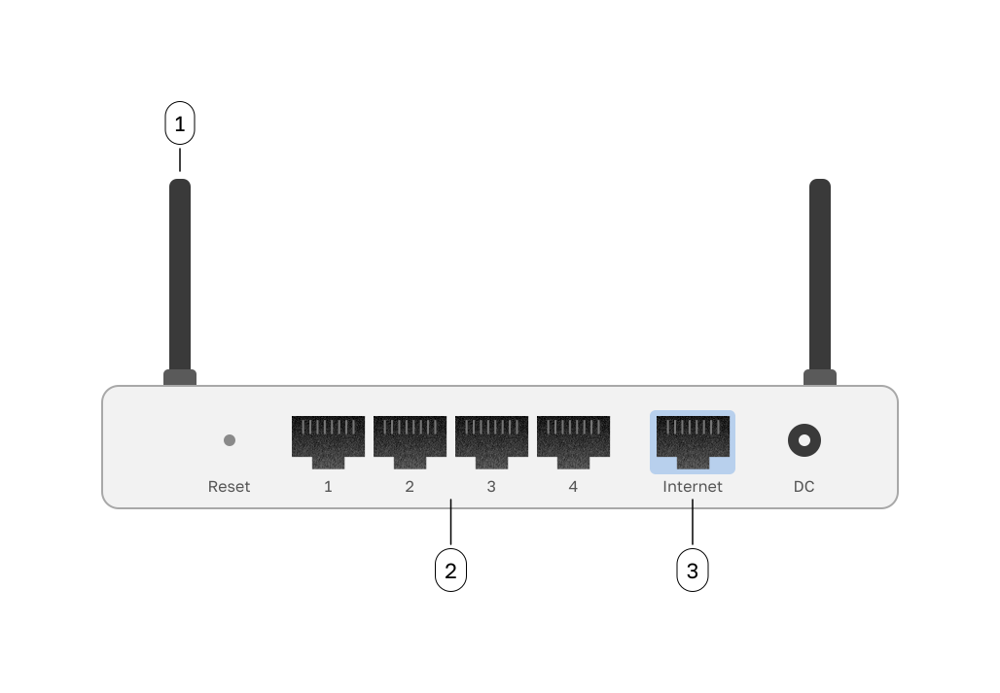
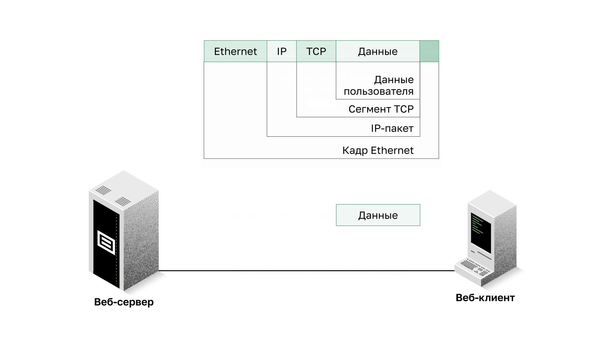

<!-- verified: agorbachev 03.05.2022 -->

<!-- 4.1.1 -->
## Физическое подключение

Независимо от того, подключаетесь ли вы к домашнему принтеру или же к сайту в другой стране, для передачи данных по сети необходимо сначала установить физическое подключение к локальной сети. В качестве физического подключения может использоваться проводное соединение с помощью кабеля или беспроводное соединение по радиоканалу.

Тип используемого физического подключения зависит от конфигурации сети. Например, в офисах многих компаний сотрудники используют компьютеры или ноутбуки, физически подключенные кабелями к общему коммутатору. Сети такого типа называют **проводными**. Данные в них передаются по физическому кабелю.

Помимо возможности проводного подключения многие компании обеспечивают **беспроводное подключение** для ноутбуков, планшетов и смартфонов. При использовании беспроводных устройств данные передаются с помощью радиоволн. Такое подключение широко распространено, потому что частные пользователи и предприятия одинаково чувствуют его преимущества. При этом подключении устройства в сети должны подключаться к беспроводной точке доступа (**AP**) или к беспроводному маршрутизатору.

### Беспроводной маршрутизатор

Компоненты беспроводного маршрутизатора:

1.  беспроводные антенны (у одних моделей они внешние, у других встроены в корпус);
2.  несколько коммутационных портов Ethernet, например четыре;
3.  порт подключения к сети Интернет.

<!--
back of a wireless router showing four Ethernet switchports and an Internet port
-->

Подобно корпоративному офису, большинство домов предлагают как проводное, так и беспроводное подключение к сети. Например, ноутбук можно подключить кабелем Ethernet к одному из коммутационных портов домашнего беспроводного маршрутизатора и через него — к локальной сети (LAN).

### Проводное подключение к беспроводному маршрутизатору

<!--
a laptop with a wired connection into an Ethernet switchport on a wireless router
-->

**Сетевые интерфейсные платы**

**Сетевые интерфейсные платы** (Network Interface Card, NIC) служат для подключения устройства к сети. Платы Ethernet используются для проводного подключения (кабель Ethernet подключается к порту RJ-45 сетевой платы), а платы беспроводной локальной сети (Wireless Local Area Network, WLAN) — для беспроводного подключения. Устройство конечного пользователя может содержать один или оба типа сетевых плат. Например, если сетевой принтер оснащен только сетевой платой Ethernet, то он должен подключаться к сети с помощью кабеля Ethernet. Другие устройства, например, планшеты и смартфоны, могут быть оснащены только сетевой платой WLAN и поэтому для них необходимо использовать беспроводное подключение.

### Проводное подключение с использованием сетевой интерфейсной платы Ethernet

<!--
someone plugging an Ethernet cable into a laptop RJ45 port
-->

С точки зрения производительности не все физические соединения равноценны.

<!-- 4.1.2 -->
## Физический уровень

Физический уровень OSI обеспечивает средства **транспортировки** битов, образующих кадр данных канального уровня, через сетевое подключение. Этот уровень принимает от канального уровня целый кадр данных и кодирует его в виде последовательности сигналов, которые затем пересылаются по средству подключения локальной сети. Закодированные биты, из которых состоит кадр, принимаются либо оконечным, либо промежуточным устройством.

Последний этап **инкапсуляции** — отправка битов через физическую среду. Физический уровень кодирует кадры и формирует электрические, оптические или радиосигналы, с помощью которых представлена информация о битах в каждом кадре. Затем эти сигналы последовательно передаются через средства подключения.

Физический уровень узла назначения принимает эти отдельные сигналы от средств подключения, **восстанавливает** представляемые ими биты и передает эти биты на канальный уровень в виде целого кадра.

<!-- 4.1.3 -->
<!-- quiz -->

