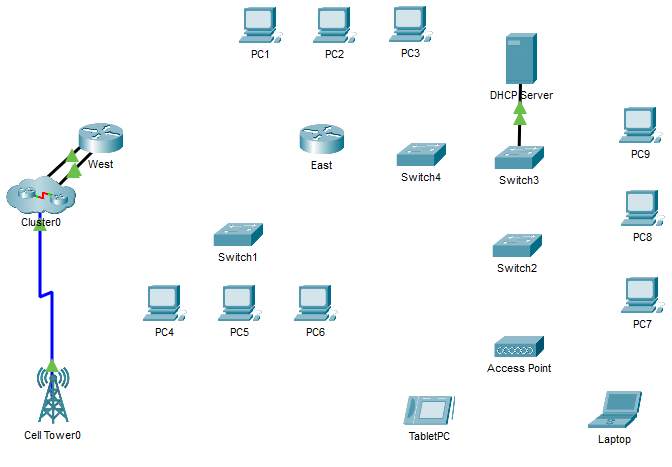

---

> **ВАЖНО**
> 
> Форма для ответов на вопросы будет доступна только при развертывании лабораторной работы 

---

## Топология



Лабораторная работа выполняется в симуляторе. Схема с устройствами открывается по адресу лаборатории; нажмите на устройство на схеме, чтобы открыть его консоль. Соединения между устройствами вы создадите в части 3.

## Цели

Часть 1. Определить физические характеристики межсетевых устройств

Часть 2. Выбрать подходящие модули для подключения

Часть 3. Подключить устройства

Часть 4. Проверить подключение

## Общие сведения

В этом упражнении вы изучите различные параметры межсетевых устройств, определите, настройка каких параметров позволяет установить надежное соединение при подключении нескольких устройств, добавите соответствующие модули и подключите устройства.

**Примечание.** Работа оценивается по соединениям между устройствами и по вашим ответам на вопросы из инструкций.

### Часть 1. Определение физических характеристик межсетевых устройств

**Шаг 1. Определите порты управления маршрутизатора Cisco**

1.  Нажмите на роутер **East.** Вкладка **Physical** (физический) должна быть активна.

2.  Увеличьте масштаб и разверните окно, чтобы видеть весь роутер.

    - Ответьте на вопрос №1

**Шаг 2. Определите LAN и WAN-интерфейсы на роутере Cisco**

1.  Ответьте на вопрос №2

2.  Откройте консоль **East** (нажмите на него на схеме), нажмите клавишу **Enter** для доступа к приглашению пользовательского режима и введите следующие команды:

    ```
    East> show ip interface brief
    ```

    Выходные данные подтверждают правильное количество интерфейсов и их обозначение. Интерфейс **vlan1** является виртуальным и существует только в программном обеспечении.

    - Ответьте на вопрос №3

3.  Введите следующие команды:

    ```
    East> show interface gigabitethernet 0/0
    ```

    - Ответьте на вопрос №4

    ```
    East> show interface serial 0/0/0
    ```

    - Ответьте на вопрос №5

    **Примечание.** Пропускная способность на последовательных интерфейсах используется процессами маршрутизации для определения наилучшего пути к адресу назначения. Это значение не отражает фактическую пропускную способность интерфейса, так как она согласовывается с поставщиком услуг.

**Шаг 3. Определите на коммутаторах слоты расширения для модулей**

- Ответьте на вопрос №6

Нажмите коммутатор **Switch2**. 

- Ответьте на вопрос №7

### Часть 2. Выбор подходящих модулей для подключения

**Шаг 1. Определите модули, обеспечивающие необходимое подключение**

1.  Нажмите на роутер **East** и откройте вкладку **Physical** (физический). Слева под меткой **Modules** (модули) отображаются доступные варианты расширения возможностей роутера. Щелкните каждый из них. Внизу будет показано его изображение и дано описание. Изучите эти варианты.

1.  Вам нужно подключить компьютеры PC1, 2 и 3 к роутеру **East**, но у вас недостаточно средств для приобретения нового коммутатора. 
    
    - Ответьте на вопрос №8

    - Ответьте на вопрос №9

2.  Нажмите коммутатор **Switch2**.

    - Ответьте на вопрос №10

**Шаг 2. Определите порты установленных модулей**

В симуляторе подходящие модули уже установлены в маршрутизатор **East** и коммутатор **Switch2**, а устройства включены.

1.  Откройте консоль **Switch2** (нажмите на него на схеме) и с помощью команды **show ip interface brief** определите слот, в который установлен модуль.

    - Ответьте на вопрос №11

### Часть 3. Подключение устройств

Возможно, для вас это первое упражнение, в котором вы должны подключить устройства. Вы еще можете не знать назначение различных типов кабелей. Чтобы успешно подключить все устройства, воспользуйтесь приведенной ниже таблицей и следуйте соответствующим рекомендациям.

1.  Наведите указатель на первое устройство и нажмите «Соединить» (или щелкните устройство правой кнопкой мыши и выберите «Соединить»), затем щелкните второе устройство.

2.  Выберите тип кабеля и порты обоих устройств, указанные в таблице, и нажмите «Соединить».

**Пример.** Чтобы подключить маршрутизатор **East** к коммутатору **Switch1**, наведите указатель на **East**, нажмите «Соединить» и щелкните **Switch1**. Выберите тип кабеля **Copper Straight-Through** (медный прямой), порт **GigabitEthernet0/0** на East и порт **GigabitEthernet0/1** на Switch1, затем нажмите «Соединить».

**Примечание.** В данном упражнении световой индикатор сети отключен.

| **Устройство** | **Интерфейс** | **Тип кабеля** | **Устройство** | **Интерфейс** |
| - | - | - | - | - |
| East | GigabitEthernet0/0 | Copper Straight-Through (Медный прямой) | Switch1 | GigabitEthernet0/1 |
| East | GigabitEthernet0/1 | Copper Straight-Through (Медный прямой) | Switch4 | GigabitEthernet0/1 |
| East | FastEthernet0/1/0 | Copper Straight-Through (Медный прямой) | PC1 | FastEthernet0 |
| East | FastEthernet0/1/1 | Copper Straight-Through (Медный прямой) | PC2 | FastEthernet0 |
| East | FastEthernet0/1/2 | Copper Straight-Through (Медный прямой) | PC3 | FastEthernet0 |
| Switch1 | FastEthernet0/1 | Copper Straight-Through (Медный прямой) | PC4 | FastEthernet0 |
| Switch1 | FastEthernet0/2 | Copper Straight-Through (Медный прямой) | PC5 | FastEthernet0 |
| Switch1 | FastEthernet0/3 | Copper Straight-Through (Медный прямой) | PC6 | FastEthernet0 |
| Switch4 | GigabitEthernet0/2 | Copper Cross-Over (Медный перекрестный) | Switch3 | GigabitEthernet3/1 |
| Switch3 | GigabitEthernet5/1 | Fiber (Оптоволоконный) | Switch2 | GigabitEthernet5/1 |
| Switch2 | FastEthernet0/1 | Copper Straight-Through (Медный прямой) | PC7 | FastEthernet0 |
| Switch2 | FastEthernet1/1 | Copper Straight-Through (Медный прямой) | PC8 | FastEthernet0 |
| Switch2 | FastEthernet2/1 | Copper Straight-Through (Медный прямой) | PC9 | FastEthernet0 |
| Switch2 | Gigabit3/1 | Copper Straight-Through (Медный прямой) | AccessPoint | Port 0 |
| East | Serial0/0/0 | Serial DCE (Последовательный DCE)<br />(подключается сначала к маршрутизатору East) | West | Serial0/0/0 |

### Часть 4. Проверка подключения

**Шаг 1. Проверьте состояние интерфейсов маршрутизатора East**

1.  Откройте консоль **East** (нажмите на него на схеме) и введите следующую команду:

    ```
    East> show ip interface brief
    ```

    Сравните выходные данные со следующими:

    ```
    Interface IP-Address OK? Method Status Protocol
    GigabitEthernet0/0 172.30.1.1 YES manual up up
    GigabitEthernet0/1 172.31.1.1 YES manual up up
    Serial0/0/0 10.10.10.1 YES manual up up
    Serial0/0/1 unassigned YES unset down down
    FastEthernet0/1/0 unassigned YES unset up up
    FastEthernet0/1/1 unassigned YES unset up up
    FastEthernet0/1/2 unassigned YES unset up up
    FastEthernet0/1/3 unassigned YES unset down down
    Vlan1 172.29.1.1 YES manual up up
    ```

    Если все кабели соединены верно, вывод должен совпадать.

**Шаг 2. Проверьте возможность подключения других ПК**

Все компьютеры должны подключаться к сайту и друг к другу. Вы научитесь использовать тестирование подключения во многих будущих лабораторных работах.

<!-- [Скачать файл Packet Tracer для локального запуска](./assets/4.7.1-lab.pka) -->
