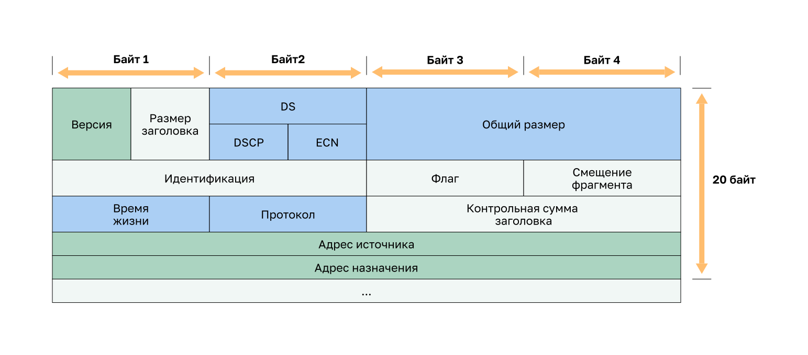

<!-- verified: agorbachev 03.05.2022 -->

<!-- 8.2.1 -->
## Заголовок пакета IPv4

IPv4 является одним из основных протоколов связи сетевого уровня. Заголовок пакета IPv4 используется для обеспечения доставки пакета на следующую остановку по пути к устройству назначения.

Заголовок пакета IPv4 состоит из нескольких полей, включающих важную информацию о пакете. Эти поля содержат двоичные числа, которые анализируются процессом уровня 3.

<!-- 8.2.2 -->
## Поля заголовка пакета IPv4

Двоичные значения каждого поля определяют различные параметры IP-пакета. Схема заголовка протокола читается слева направо и сверху вниз, по 4 байта в строке. Заголовок IPv4 без параметров занимает 20 байт: в первой строке — поля «Версия», «Размер заголовка», DS (DSCP и ECN) и «Общий размер»; во второй — «Идентификация», «Флаги» и «Смещение фрагмента»; в третьей — «Время жизни», «Протокол» и «Контрольная сумма заголовка»; затем идут «Адрес источника» и «Адрес назначения».

Среди наиболее важных полей в заголовке IPv4 можно выделить несколько.

* **Версия.** Содержит 4-битное двоичное значение, определяющее версию IP-пакета. Для пакетов IPv4 в этом поле всегда указано значение 0100.
* **Дифференцированные сервисы (Differentiated Services, DS).** Поле, которое ранее называлось «Тип сервиса» (Type of Service, ToS). DS — это 8-битное поле, используемое для определения приоритета каждого пакета. 6 наиболее важных битов поля дифференцированных услуг (DSCP) и последние 2 бита — это биты явного уведомления о перегрузке (ECN).
* **Контрольная сумма заголовка.** Используется для обнаружения повреждения в заголовке IPv4.
* **Время жизни (Time-to-Live, TTL).** Содержит 8-битное двоичное значение, которое ограничивает время нахождения пакета в сети. Отправитель пакета устанавливает начальное значение TTL, и оно уменьшается на единицу каждый раз при обработке пакета маршрутизатором. Если значение в поле TTL уменьшается до нуля, маршрутизатор отбрасывает пакет и отправляет на IP-адрес источника сообщение протокола ICMP (управление сообщениями в сети) о превышении времени жизни (Time Exceeded). Поскольку маршрутизатор уменьшает TTL каждого пакета, он также должен пересчитать контрольную сумму заголовка.
* **Протокол.** Это поле используется для определения протокола следующего уровня. Это 8-битное двоичное значение, указывающее тип полезной нагрузки данных, которые переносит пакет, что позволяет сетевому уровню пересылать данные на соответствующий протокол более высокого уровня. Обычно используются значения ICMP (1), TCP (6) и UDP (17).
* **IPv4-адрес источника.** Содержит 32-битное двоичное значение, которое представляет IPv4-адрес источника пакета. IPv4-адрес источника — это всегда индивидуальный адрес.
* **IPv4-адрес назначения.** Содержит 32-битное двоичное значение, которое представляет IPv4-адрес назначения пакета. IPv4-адрес назначения — одноадресная рассылка, многоадресная рассылка или широковещательный адрес.

Два наиболее часто используемых поля — это IP-адрес источника и IP-адрес назначения. Эти поля определяют, откуда поступил пакет и куда он направляется. Обычно в процессе передачи от узла источника к узлу назначения эти адреса не меняются.

Поля «Размер заголовка» (Internet Header Length, IHL), «Общий размер» и «Контрольная сумма заголовка» используются для определения и проверки пакета.

Остальные поля используются для переупорядочивания фрагментированного пакета. В связи с этим IPv4-пакет использует поля «Идентификация», «Флаги» и «Смещение фрагмента» для отслеживания фрагментов. Маршрутизатору может понадобиться выполнить фрагментацию пакета IPv4 при его пересылке из одной среды передачи данных в другую среду с меньшим максимальным размером передаваемого блока данных (MTU).

Поля «Параметры» и «Заполнитель» используются редко и в данной главе не рассматриваются.

<!-- 8.2.3 -->
## Наблюдение за заголовками пакетов IPv4

Поля заголовка IPv4 можно увидеть в реальных пакетах: в анализаторе пакетов или в режиме симуляции, где у каждого события есть окно PDU с заголовками пакета по уровням. В примере клиент PC1 (192.168.1.109) открывает веб-страницу на сервере Web-Server (192.168.1.1) в той же сети, а затем отправляет ему ping. Рассмотрим заголовки трех пакетов: сегмента TCP SYN, запроса HTTP GET и эхо-запроса ICMP.

1. Веб-браузер PC1 открывает адрес http://192.168.1.1. Первый пакет — сегмент TCP SYN, которым клиент открывает соединение с портом 80 сервера. В его заголовке IPv4 поле «Версия» равно 4, а «Размер заголовка» (IHL) — 5. Размер заголовка считается в 4-байтовых словах: 5 × 4 = 20 байт, то есть заголовок без параметров.
2. В поле DS оба значения равны 0: DSCP не задает пакету особого приоритета, ECN (явное уведомление о перегрузке) не используется. «Общий размер» равен 40 байтам: 20 байт заголовка IPv4 и 20 байт заголовка TCP. Данных у сегмента SYN нет.
3. Поля «Идентификация», «Флаги» и «Смещение фрагмента» используются для отслеживания фрагментов. У сегмента SYN флаг DF (Don't Fragment) равен 1: маршрутизаторам запрещено фрагментировать этот пакет. Флаг MF и смещение фрагмента равны 0 — пакет не фрагментирован.
4. «Время жизни» (TTL) равно 128 — это начальное значение, которое задал отправитель. Поле «Протокол» равно 6: в пакете переносится сегмент TCP, и его заголовок идет после заголовка IPv4. Контрольная сумма заголовка позволяет обнаружить его повреждение. Адрес источника — 192.168.1.109, адрес назначения — 192.168.1.1.
5. Следующий пакет — запрос HTTP GET в сегменте TCP с данными. Поля заголовка IPv4 те же, но «Общий размер» равен 77 байтам: 20 байт IPv4, 20 байт TCP и 37 байт запроса HTTP `GET / HTTP/1.1`. Значение поля «Идентификация» у каждого пакета свое, поэтому другая и контрольная сумма.
6. Затем PC1 отправляет ping — эхо-запрос ICMP. Поле «Протокол» равно 1 (ICMP), а после заголовка IPv4 идет заголовок ICMP с типом 8 (эхо-запрос). Флаг DF у этого пакета равен 0: маршрутизатор может его фрагментировать, если пакет не проходит по MTU. «Общий размер» равен 60 байтам: 20 байт IPv4 и 40 байт ICMP — 8 байт заголовка и 32 байта данных.
7. У всех трех пакетов одинаковы версия, размер заголовка, TTL и адреса. От пакета к пакету меняются общий размер, идентификация, флаги и протокол, а вместе с ними — контрольная сумма заголовка.

<!-- 8.2.4 -->
<!-- quiz -->

