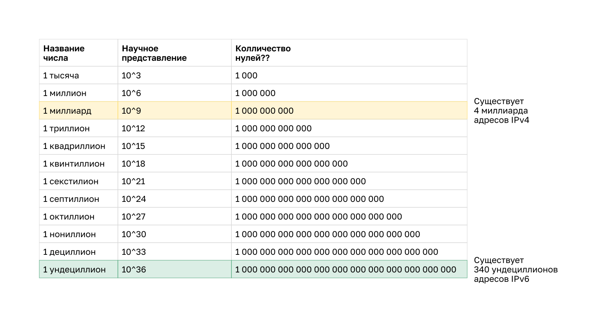
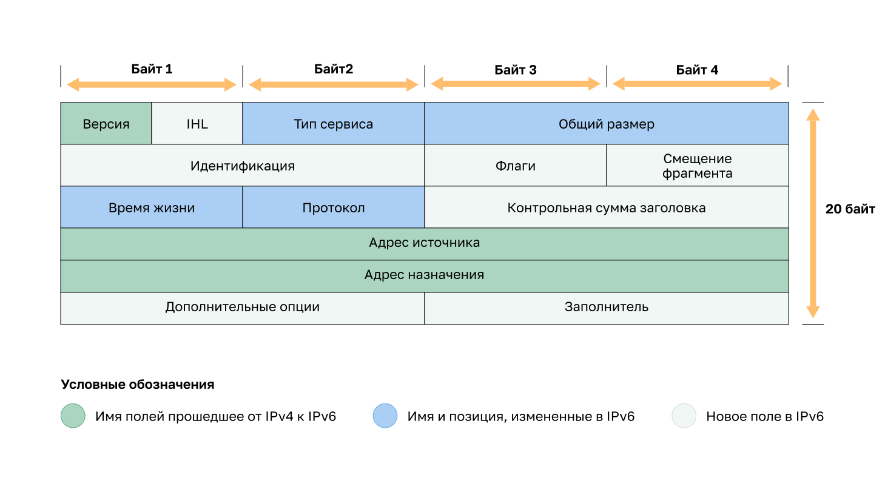
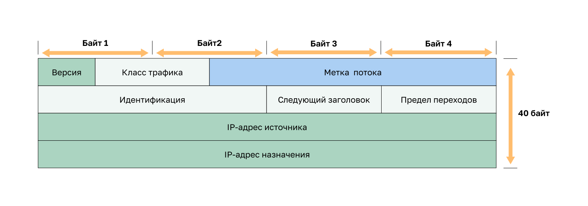

<!-- verified: agorbachev 03.05.2022 -->

<!-- 8.3.1 -->
## Ограничения IPv4

IPv4 по-прежнему используется и сегодня. Этот раздел посвящен IPv6, который в конечном итоге заменит IPv4. Вам нужно знать протокол IPv6, чтобы понять ограничения IPv4 и преимущества IPv6.

На протяжении многих лет разрабатывались дополнительные протоколы и процессы для решения новых задач. Тем не менее даже в результате изменений IPv4 по-прежнему имеет три основных недостатка.

* **Нехватка IP-адресов.** IPv4 может предложить лишь ограниченное количество уникальных публичных адресов. Несмотря на то, что существует примерно 4 миллиарда IPv4-адресов, возросшее число новых устройств, в которых используется протокол IP, а также потенциальный рост менее развитых регионов привели к необходимости дополнительного увеличения количества адресов.
* **Нехватка сквозных соединений.** Преобразование сетевых адресов (NAT) представляет собой технологию, которая обычно применяется в сетях IPv4. NAT позволяет различным устройствам совместно использовать один публичный IPv4-адрес. При этом, поскольку публичный IPv4-адрес используется совместно, IPv4-адрес узла внутренней сети скрыт. Это может представлять проблему при использовании технологий, для которых необходимы сквозные соединения.
* **Повышенная сложность сети.** Несмотря на то, что NAT продлил срок службы IPv4, он был предназначен только как механизм перехода на IPv6. NAT в своей разнообразной реализации создает дополнительную сложность в сети, создавая задержку и затрудняя поиск и устранение неисправностей.

<!-- 8.3.2 -->
## Обзор IPv6

В начале 90-х годов специалисты инженерной группы по развитию Интернета (IETF) подняли вопрос о недостатках протокола IPv4 и начали поиски альтернативных решений. Результатом поисков стала разработка протокола IP версии 6 (IPv6). Он помогает преодолеть ограничения протокола IPv4 и значительно расширяет доступные возможности, предлагая функции, которые оптимально соответствуют текущим и прогнозируемым сетевым требованиям.

Протокол IPv6 предлагает ряд улучшений.

* **Расширенное адресное пространство.** IPv6-адреса используют 128-битную иерархическую адресацию, в отличие от протокола IPv4, использующего 32 бита.
* **Улучшенная обработка пакетов.** Структура заголовка IPv6 была упрощена благодаря уменьшению количества полей.
* **Отсутствие необходимости в использовании NAT.** Благодаря большому количеству публичных IPv6-адресов нет необходимости в преобразовании сетевых адресов (NAT) между частными и публичными адресами IPv4. Это позволяет избежать некоторых проблем, связанных с NAT, с которыми сталкиваются приложения, требующие сквозного подключения.

32-битное адресное пространство IPv4 предусматривает примерно 4 294 967 296 уникальных адресов. Адресное пространство протокола IPv6 поддерживает 340 282 366 920 938 463 463 374 607 431 768 211 456 или 340 ундециллионов адресов. Это примерно эквивалентно каждой песчинке на Земле.

Для сравнения: IPv4-адресов около 4 миллиардов (миллиард — это 109), а IPv6-адресов — 340 ундециллионов (ундециллион — это 1036).

### Сравнение адресного пространства IPv4 и IPv6

<!-- 8.3.3 -->
## Поля заголовка пакета IPv4 в заголовке пакета IPv6

Одним из основных конструктивных улучшений протокола IPv6 по сравнению с IPv4 является упрощенный заголовок IPv6.

Например, заголовок IPv4 состоит из 20 октетов (до 60 байт, если используется поле «Параметры») и 12 основных полей заголовка (не учитывая поля «Параметры» и «Заполнитель»).

В IPv6 некоторые поля остались прежними, некоторые поля IPv4 более не используются, а в некоторых изменены названия и расположение.

### Заголовок пакета IPv4

Поля заголовка IPv4 делятся на три группы.

* Поля, которые сохранили одно и то же имя: версия, адрес источника и адрес назначения.  
* Поля, которые изменили имена и положение: тип службы, общая длина, время жизни и протокол.  
* Поля, которые не были сохранены в IPv6: IHL, идентификация, флаги, смещение фрагмента, контрольная сумма заголовка, параметры и заполнение.

<!-- 8.3.4 -->
## Заголовок пакета IPv6 

Заголовок IPv6 имеет фиксированную длину 40 байт: в первой строке — поля «Версия», «Класс трафика» и «Метка потока», во второй — «Длина полезной нагрузки», «Следующий заголовок» и «Предел переходов», а затем идут 128-битные IPv6-адреса источника и назначения.

### Поля в заголовке пакета IPv6

Поля в заголовке пакета IPv6.

* **Версия** — данное поле содержит 4-битное двоичное значение, которое определяет версию IP-пакета. Для пакетов IPv6 в этом поле всегда указано значение 0110.
* **Класс трафика** — 8-битное поле, соответствующее полю «Дифференцированные услуги (DS)» в заголовке IPv4.
* **Метка потока** — 20-битное поле указывает на то, что всем пакетам с одинаковыми метками потока назначается одинаковый тип обработки маршрутизаторами.
* **Длина полезной нагрузки** — 16-битное поле указывает длину блока данных или полезной нагрузки пакета IPv6. Это не включает длину заголовка IPv6, который является фиксированным 40-байтным заголовком.
* **Следующий заголовок** — 8-битное поле, соответствующее полю «Протокол» в заголовке IPv4. Оно указывает тип полезной нагрузки данных, которые переносит пакет, что позволяет сетевому уровню пересылать данные на соответствующий протокол более высокого уровня.
* **Предел перехода** — 8-битное поле, заменяющее поле «Время жизни» (TTL) в IPv4. Это значение уменьшается на единицу каждым маршрутизатором, пересылающим пакет. Когда счетчик достигает значения 0, пакет отбрасывается и на отправляющий узел пересылается сообщение ICMPv6, которое означает,  что пакет не достиг своего назначения, так как был превышен предел переходов. В отличие от IPv4, IPv6 не включает контрольную сумму заголовка IPv6, так как эта функция выполняется как на нижнем, так и на верхнем уровнях. Это означает, что контрольную сумму не нужно пересчитывать каждым маршрутизатором при уменьшении поля Hop Limit, что также повышает производительность сети.
* **IPv6-адрес источника** — 128-битное поле, определяющее IPv6-адрес узла-отправителя.
* **IPv6-адрес назначения** — 128-битное поле, определяющее IPv6-адрес узла-получателя.

Пакет IPv6 также может содержать заголовки расширений (EH), которые предоставляют дополнительную информацию сетевого уровня. Заголовки расширений являются дополнительными и помещаются между заголовком IPv6 и полезной нагрузкой. Заголовки расширений используются для фрагментации, обеспечения безопасности, поддержки мобильности и многого другого.

В отличие от IPv4, маршрутизаторы не делят на части направленные IPv6-пакеты.

<!-- 8.3.5 -->
## Наблюдение за заголовками пакетов IPv6

Поля заголовка IPv6 можно увидеть так же, как поля IPv4: в анализаторе пакетов или в окне PDU режима симуляции. В примере клиент PC1 (2001:db8:acad:1::10) открывает веб-страницу на сервере Web-Server (2001:db8:acad:1::1) в той же сети, а затем отправляет ping на link-local адрес сервера. Рассмотрим заголовки трех пакетов: сегмента TCP SYN, запроса HTTP GET и сообщения ICMPv6 Neighbor Solicitation.

1. Веб-браузер PC1 открывает адрес http://[2001:db8:acad:1::1] — в URL адрес IPv6 записывают в квадратных скобках. Первый пакет — сегмент TCP SYN. В его заголовке IPv6 восемь полей. Поле «Версия» равно 6, а поля «Размер заголовка» нет: заголовок IPv6 всегда занимает 40 байт.
2. «Класс трафика» равен 0 — это поле соответствует полю DS в IPv4. «Метка потока» тоже равна 0. Это новое поле: пакетам с одинаковой меткой потока маршрутизаторы назначают одинаковую обработку.
3. «Длина полезной нагрузки» равна 20 — это только заголовок TCP, который идет после заголовка IPv6. В отличие от поля «Общий размер» в IPv4, 40 байт самого заголовка в нее не входят.
4. «Следующий заголовок» равен 6 (TCP) — это поле соответствует полю «Протокол» в IPv4. «Предел переходов» равен 128 — он заменяет TTL. Контрольной суммы в заголовке IPv6 нет, поэтому маршрутизатору не нужно пересчитывать ее при уменьшении предела переходов. Адреса источника и назначения — 128-битные глобальные индивидуальные адреса из сети 2001:db8:acad:1::/64.
5. Следующий пакет — запрос HTTP GET. Поля заголовка те же, но длина полезной нагрузки равна 64: 20 байт TCP и 44 байта запроса HTTP `GET / HTTP/1.1`.
6. Затем PC1 отправляет ping на link-local адрес сервера fe80::2d0:97ff:fe57:6501. MAC-адреса этого соседа PC1 еще не знает, поэтому сначала отправляет сообщение Neighbor Solicitation (NS): по IPv6-адресу соседа оно запрашивает его MAC-адрес, как запрос ARP в IPv4. Источник NS — link-local адрес PC1 fe80::2d0:84ff:fe55:dc01: идентификатор интерфейса получен по EUI-64, с ff:fe в середине. Назначение — групповой адрес запрашиваемого узла ff02::1:ff57:6501.
7. У сообщения NS «Следующий заголовок» равен 58 (ICMPv6): после заголовка IPv6 идет сообщение ICMPv6 типа 135 с целевым адресом fe80::2d0:97ff:fe57:6501, длина полезной нагрузки — 32 байта. «Предел переходов» равен 255: сообщение NDP с меньшим значением прошло через маршрутизатор, и получатель его отбросит. Web-Server отвечает сообщением Neighbor Advertisement (NA) со своим MAC-адресом.

<!-- 8.3.6 -->
<!-- quiz -->

