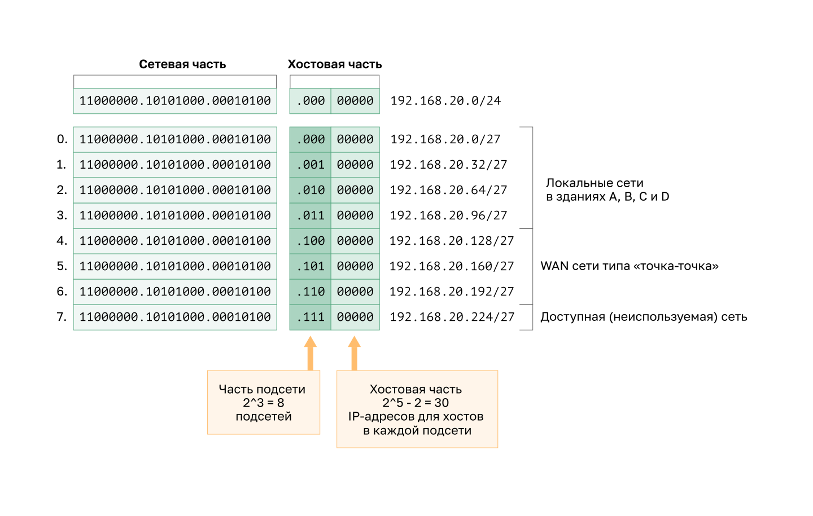
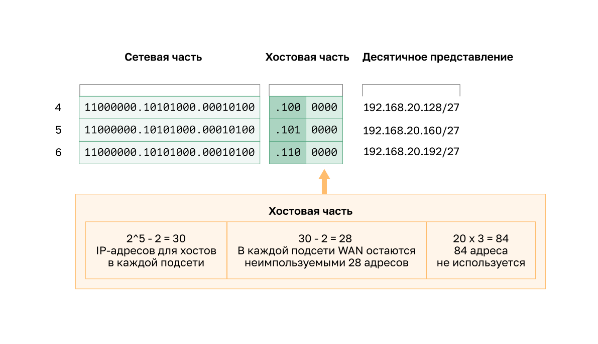
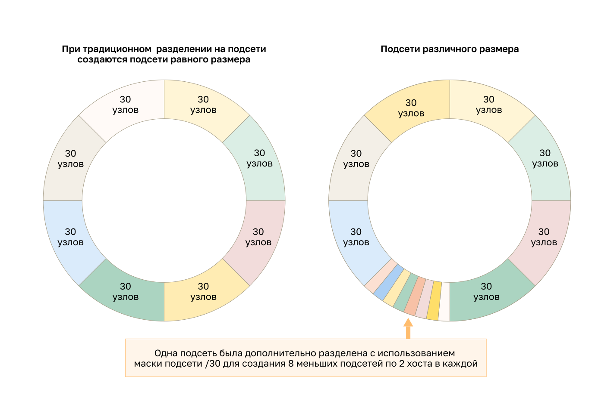
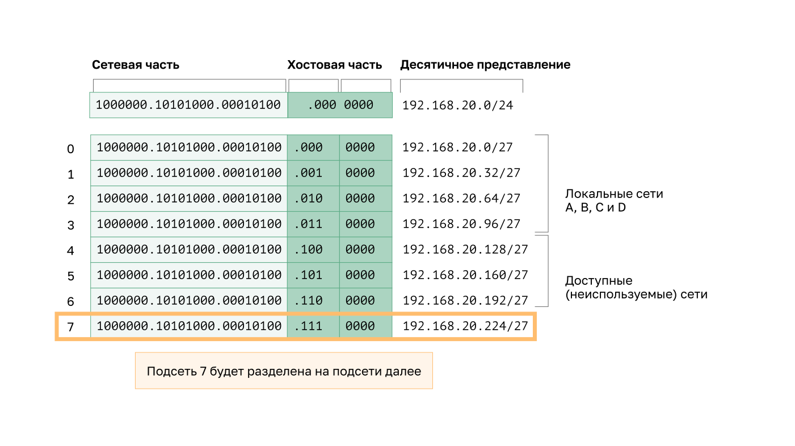
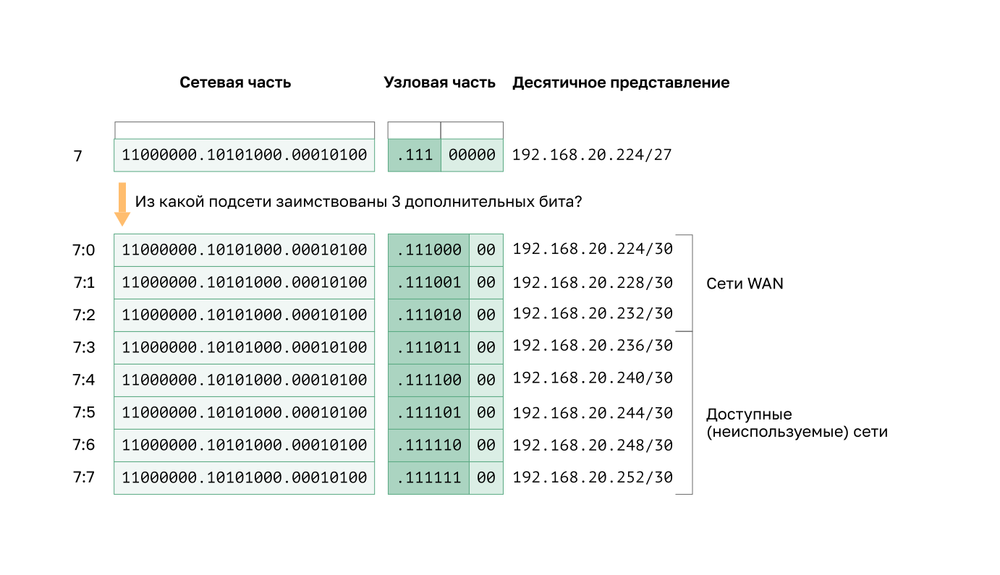

<!-- verified: agorbachev 03.05.2022 -->

<!-- 11.8.1 -->
## Видео: основы масок подсети переменной длины (variable length subnet mask, VLSM) 

Как упоминалось в предыдущем разделе, публичные и частные адреса влияют на способы размещения подсетей в вашей сети. На схемы подсетей влияют и другие проблемы. Стандартная схема подсетей /16 создает подсети с одинаковым количеством узлов. Не каждой из них потребуется столько узлов, поэтому многие IPv4 адреса остаются неиспользуемыми. Возможно, вам понадобится одна подсеть, содержащая еще много узлов. Именно для этого разработали маску подсети переменной длины (VLSM).

Посмотрите видео об основных методах и примерах VLSM.

<!-- 11.8.2 -->
## Видео: пример VLSM

Посмотрите видео о том, как разделить один блок адресов на подсети нескольких размеров.

<!-- 11.8.3 -->
## Эффективное использование IPv4-адресов

Из-за истощения общего адресного пространства IPv4, использование доступных адресов узлов стало основной проблемой для подсетей IPv4.

**Примечание**: Более крупный адрес IPv6 позволяет гораздо проще планировать и распределять адреса, чем позволяет IPv4. Это одна из движущих сил для перехода на IPv6.

В традиционном разделении для каждой подсети выделяется одинаковое количество адресов. Если у всех подсетей одинаковые требования к количеству узлов, такие блоки адресов фиксированного размера будут эффективными. Как правило, с публичными адресами IPv4 это не так.

Например, маршрутизаторы R1–R4 соединены цепочкой, и в сети нужны семь подсетей: по одной для каждой из четырех локальных сетей (LAN) — в здании А 25 узлов, в здании Б 20, в здании В 15, в здании Г 28 — и по одной для каждого из трех каналов сети WAN между маршрутизаторами, где нужно по 2 узла.

В традиционном разбиении на подсети с указанным адресом 192.168.20.0/24 из узловой части в последнем октете можно позаимствовать три бита, чтобы обеспечить создание семи подсетей. При заимствовании трех бит можно создать 8 подсетей /27 — от 192.168.20.0/27 до 192.168.20.224/27, а оставшихся пяти бит в узловой части хватит для 30 адресов узлов в каждой подсети. Такая схема позволяет создать требуемые подсети и соответствует требованиям к узлу в крупнейших локальных сетях (LAN).

Первые четыре подсети (192.168.20.0/27, 192.168.20.32/27, 192.168.20.64/27 и 192.168.20.96/27) можно назначить локальным сетям зданий А–Г, следующие три (192.168.20.128/27, 192.168.20.160/27 и 192.168.20.192/27) — каналам WAN, а подсеть 192.168.20.224/27 остается неиспользуемой.

Хотя при таком стандартном разделении на подсети обеспечивается соответствие требованиям к крупнейшим локальным сетям (LAN) и разделение пространства адресов на соответствующее количество подсетей, это все равно приводит к значительному необоснованному расходованию неиспользуемых адресов.

Например, в каждой подсети для трех каналов WAN требуется только два адреса. Поскольку каждая из подсетей содержит 30 доступных для использования адресов, в каждой из подсетей оказывается 28 неиспользуемых адресов. В результате получается 84 неиспользуемых адреса (28 × 3).

Кроме того, это также ограничивает расширение сети в будущем, уменьшая общее число доступных подсетей. Такое неэффективное использование адресов характерно для традиционного разделения на подсети, это подразумевает нецелесообразное расходование ресурсов.

Разделение подсети на несколько подсетей или использование маски подсети переменной длины (VLSM) позволяет предотвратить появление избыточных адресов.

<!-- 11.8.4 -->
## VLSM

При традиционном разделении на подсети ко всем подсетям применяется одна маска подсети, поэтому все подсети содержат одинаковое число доступных адресов узлов — например, восемь подсетей по 30 узлов. VLSM позволяет разделить пространство сети на неравные части: например, одну из таких подсетей можно дополнительно разделить маской /30 на восемь меньших подсетей по 2 узла. VLSM-маска подсети может варьироваться в зависимости от количества бит, которые были заимствованы для конкретной подсети. Эти биты образуют «переменную» часть маски.

VLSM разделяет подсети на подсети. Возьмем ту же сеть из четырех зданий и трех каналов между маршрутизаторами R1–R4, тот же адрес 192.168.20.0/24 и разделим его на семь подсетей, по одной для каждой из четырех локальных сетей и по одной для каждого из трех соединений между маршрутизаторами.

Сначала сеть 192.168.20.0/24 разбивается на восемь подсетей /27 одинакового размера с 30 используемыми адресами узлов в каждой: от 192.168.20.0/27 (подсеть 0) до 192.168.20.224/27 (подсеть 7). Подсети 0–3 используются для локальных сетей (LAN) зданий А–Г. Для трех каналов между маршрутизаторами можно было бы взять подсети 4–6, но в каждой из них 28 адресов остались бы неиспользуемыми.

Для подключения между маршрутизаторами требуется только два адреса узлов в подсети (один адрес узла для каждого интерфейса маршрутизатора). Сейчас все подсети имеют 30 используемых адресов узлов для каждой подсети. Чтобы использовать адреса эффективнее, с помощью VLSM можно создать более мелкие подсети для каналов между маршрутизаторами.

Для этого нужно разделить одну из подсетей. В этом примере последняя подсеть 192.168.20.224/27 будет дополнительно разбита на подсети с помощью маски 255.255.255.252 или /30.

Почему /30? Как вы помните, если известно необходимое количество адресов узлов, можно использовать формулу 2^n-2 (где n — количество оставшихся бит в узловой части). Чтобы получить два доступных адреса, в его узловой части должны остаться два бита.

Поскольку в разбитом на подсети адресном пространстве 192.168.20.224/27 имеются 5 бит в узловой части, 3 бита можно позаимствовать, а 2 бита оставить в узловой части: получаются восемь подсетей /30 — от 192.168.20.224/30 до 192.168.20.252/30. На данном этапе расчеты в точности совпадают с расчетами при традиционном разбиении на подсети. Биты заимствуются, определяя диапазоны подсетей. Четыре подсети /27 назначены локальным сетям (здание А — 192.168.20.0/27, Б — 192.168.20.32/27, В — 192.168.20.64/27, Г — 192.168.20.96/27), а три подсети /30 — межмаршрутизаторным каналам: R1–R2 — 192.168.20.224/30, R2–R3 — 192.168.20.228/30, R3–R4 — 192.168.20.232/30.

Такая схема VLSM-деления на подсети уменьшает количество адресов в подсети до подходящего сети размера. Разделение подсети 7 для сетей WAN оставляет доступными подсети 4, 5 и 6 для будущих сетей, а также 5 дополнительных подсетей для сетей WAN.

**Примечание**: При использовании VLSM, всегда начинайте с обеспечения соответствия требованиям к узлам в крупнейших подсетях. Продолжайте разделение, пока не будут удовлетворены требования к узлам в наименьшей подсети.

<!-- 11.8.5 -->
## Назначение адресов в топологии VLSM

При использовании VLSM-подсетей для сегментов локальной (LAN) и глобальной (WAN) сетей можно выделять адреса без ненужных потерь.

Каждому интерфейсу маршрутизатора назначается IPv4-адрес из его подсети. LAN-интерфейс G0/0/0 получает первый адрес подсети своего здания: R1 — 192.168.20.1/27, R2 — 192.168.20.33/27, R3 — 192.168.20.65/27, R4 — 192.168.20.97/27. В каналах /30 два интерфейса получают два адреса канала: R1 — 192.168.20.225 и R2 — 192.168.20.226, R2 — 192.168.20.229 и R3 — 192.168.20.230, R3 — 192.168.20.233 и R4 — 192.168.20.234.

В стандартной схеме адресации IPv4-адрес первого узла в каждой подсети назначается LAN-интерфейсу маршрутизатора. У узлов в каждой подсети будут IPv4-адреса из диапазона этой подсети и соответствующую маску. Узлы будут использовать адрес подключенного LAN-интерфейса маршрутизатора в качестве адреса шлюза по умолчанию.

В таблице показаны сетевые адреса и диапазон адресов узлов для каждой сети. Адрес шлюза по умолчанию отображается для четырех локальных сетей.

|  | **Сетевой адрес** | **Диапазон адресов узлов** | **Адрес шлюза по умолчанию** |
| --- | --- | --- | --- |
| **Здание А** | 192.168.20.0/27 | 192.168.20.1/27 - 192.168.20.30/27 | 192.168.20.1/27 |
| **Здание Б** | 192.168.20.32/27 | 192.168.20.33/27 - 192.168.20.62/27 | 192.168.20.33/27 |
| **Здание В** | 192.168.20.64/27 | 192.168.20.65/27 - 192.168.20.94/27 | 192.168.20.65/27 |
| **Здание Г** | 192.168.20.96/27 | 192.168.20.97/27 - 192.168.20.126/27 | 192.168.20.97/27 |
| **R1-R2** | 192.168.20.224/30 | 192.168.20.225/30 - 192.168.20.226/30 |  |
| **R2-R3** | 192.168.20.228/30 | 192.168.20.229/30 - 192.168.20.230/30 |  |
| **R3-R4** | 192.168.20.232/30 | 192.168.20.233/30 - 192.168.20.234/30 |  |

## Пример: подсети нескольких размеров

Рассмотрим блок 172.16.0.0/23 — 512 адресов, от 172.16.0.0 до 172.16.1.255. Из него нужно выделить подсети на 200, 100, 50, 25 и 10 узлов и четыре канала «точка-точка» по 2 узла.

Сначала каждое требование переводится в размер блока: к числу узлов прибавляются сетевой и широковещательный адреса, и берётся ближайший подходящий блок — 4, 8, 16, 32, 64, 128, 256 … адресов.

| **Требование** | **Нужно адресов** | **Блок, адресов** | **Префикс** |
| --- | --- | --- | --- |
| 200 узлов | 202 | 256 | /24 |
| 100 узлов | 102 | 128 | /25 |
| 50 узлов | 52 | 64 | /26 |
| 25 узлов | 27 | 32 | /27 |
| 10 узлов | 12 | 16 | /28 |
| 4 канала по 2 узла | 4 на канал | 4 × 4 = 16 | /30 |

Сумма блоков — 256 + 128 + 64 + 32 + 16 + 16 = 512: блок /23 занят целиком, резерва нет.

Затем блок делится, начиная с самой большой подсети: оставшаяся часть каждый раз делится пополам: одна половина отдаётся под требование, другая делится дальше. Какую половину брать, неважно — важно, чтобы диапазоны подсетей не пересекались.

| **Подсеть** | **Маска** | **Адресов** | **Узлов** | **Диапазон адресов узлов** | **Широковещательный адрес** |
| --- | --- | --- | --- | --- | --- |
| 172.16.0.0/24 | 255.255.255.0 | 256 | 254 | 172.16.0.1 – 172.16.0.254 | 172.16.0.255 |
| 172.16.1.0/25 | 255.255.255.128 | 128 | 126 | 172.16.1.1 – 172.16.1.126 | 172.16.1.127 |
| 172.16.1.128/26 | 255.255.255.192 | 64 | 62 | 172.16.1.129 – 172.16.1.190 | 172.16.1.191 |
| 172.16.1.192/27 | 255.255.255.224 | 32 | 30 | 172.16.1.193 – 172.16.1.222 | 172.16.1.223 |
| 172.16.1.224/28 | 255.255.255.240 | 16 | 14 | 172.16.1.225 – 172.16.1.238 | 172.16.1.239 |
| 172.16.1.240/30 | 255.255.255.252 | 4 | 2 | 172.16.1.241 – 172.16.1.242 | 172.16.1.243 |
| 172.16.1.244/30 | 255.255.255.252 | 4 | 2 | 172.16.1.245 – 172.16.1.246 | 172.16.1.247 |
| 172.16.1.248/30 | 255.255.255.252 | 4 | 2 | 172.16.1.249 – 172.16.1.250 | 172.16.1.251 |
| 172.16.1.252/30 | 255.255.255.252 | 4 | 2 | 172.16.1.253 – 172.16.1.254 | 172.16.1.255 |

Каждая следующая подсеть начинается сразу за широковещательным адресом предыдущей, поэтому диапазоны не пересекаются.

<!-- 11.8.6 -->

<!-- ## Задание - Практика VLSM -->

