<!-- verified: agorbachev 03.05.2022 -->

<!-- 14.5.1 -->
## Процессы TCP-сервера

Вы уже знаете основы TCP. Понимание роли номеров портов поможет вам разобраться в деталях процесса связи TCP. В этом разделе вы узнаете о трехстороннем рукопожатии TCP и о завершении сеанса.

Каждый процесс приложения сервере использует номер порта. Он автоматически назначается или настраивается системным администратором вручную.

Не допускается использование двумя различными службами на сервере одного и того же порта с одинаковым протоколом транспортного уровня. Например, приложение веб-сервера и приложение передачи файлов, которые запущены на одном узле, нельзя настроить на использование одного и того же порта (например, TCP-порта 80).

Активное серверное приложение, которому присвоен определенный порт, считается открытым. Это значит, что транспортный уровень может принимать и обрабатывать сегменты, направляемые на этот порт. Принимается любой входящий запрос, адресованый правильному сокету, а данные передаются приложению сервера. На сервере можно открыть одновременно несколько портов, по одному для каждого активного приложения.

Клиент 1 запрашивает веб-службы, а Клиент 2 запрашивает службу электронной почты, используя известные порты (например, веб-службы — порт 80, службы электронной почты — порт 25).

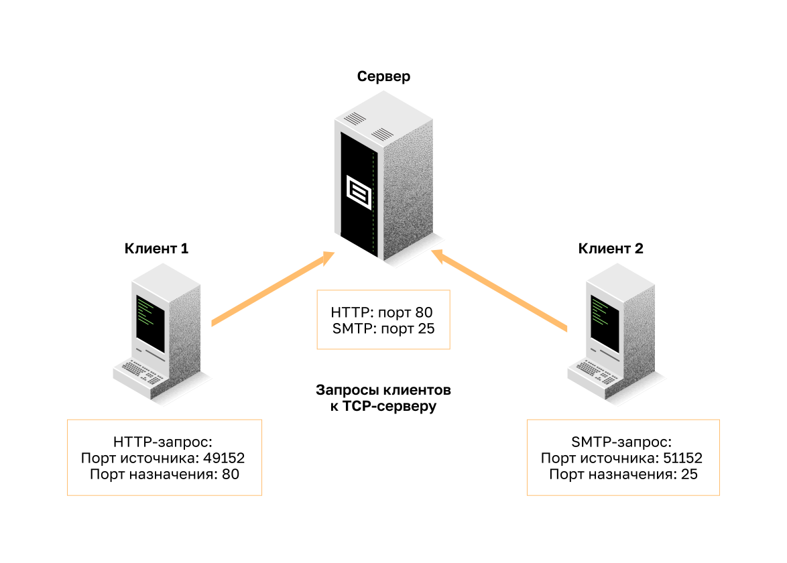

Запросы динамически генерируют номер порта источника. В этом случае клиент 1 использует порт источника 49152, а клиент 2 — порт источника 51152.

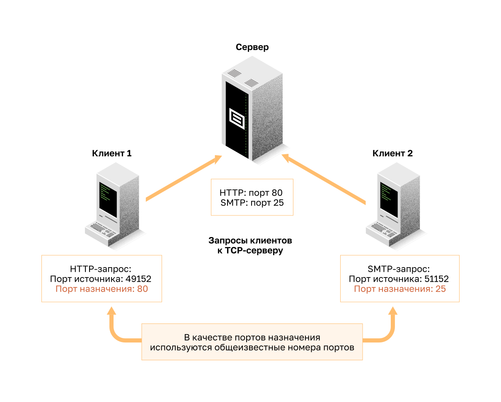

Когда сервер отвечает на запросы клиента, он меняет порты назначения и источника исходного запроса.

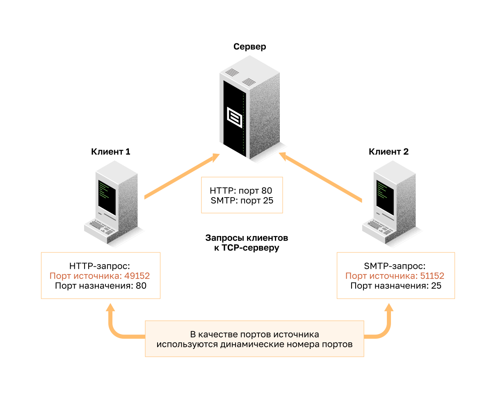

Обратите внимание, что у ответа сервера на веб-запрос теперь порт назначения 49152, а у ответа электронной почты — 51152.

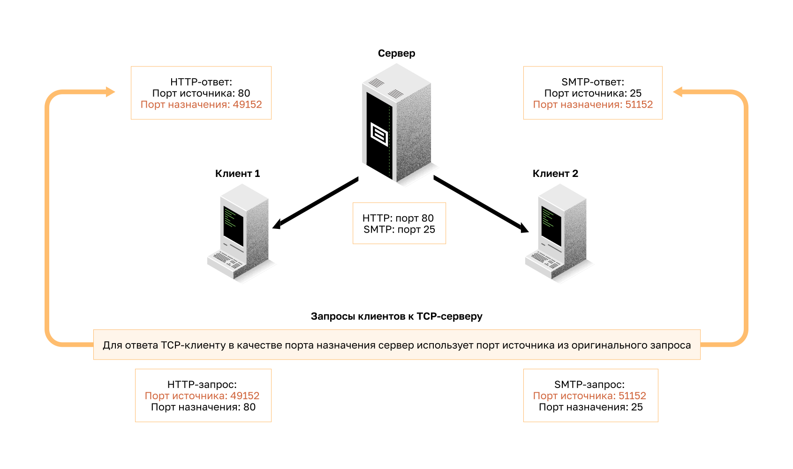

Порт источника в ответе сервера — исходный порт назначения в первоначальных запросах.

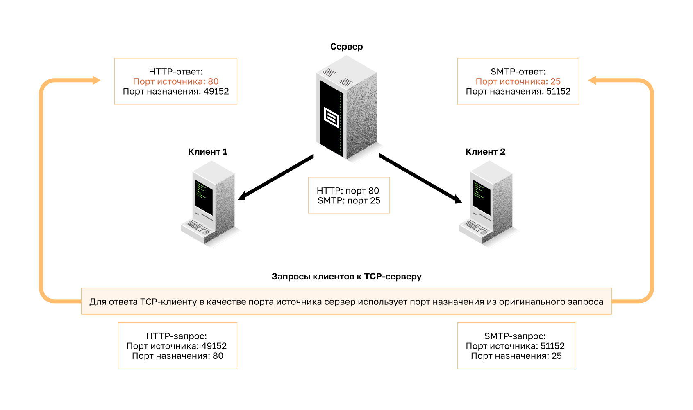

<!-- 14.5.2 -->
## Установление TCP-соединения

В некоторых странах при встрече двух человек принято обмениваться рукопожатиями. Обе стороны понимают это как сигнал для дружеского приветствия. Подключения в сети осуществляются примерно так же. В соединениях TCP клиент узла устанавливает подключается к серверу, используя процесс трехстороннего рукопожатия.

**Шаг 1. SYN** — инициирующий клиент запрашивает сеанс связи типа «клиент-сервер» с сервером.

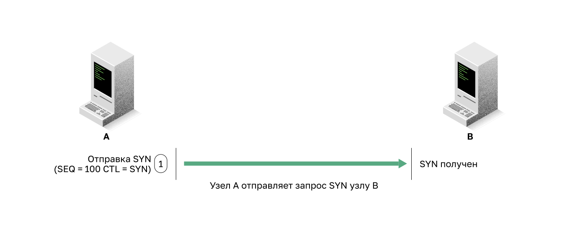

**Шаг 2. ACK и SYN** — сервер подтверждает сеанс обмена данными «клиент-сервер» и запрашивает сеанс обмена данными «сервер-клиент».

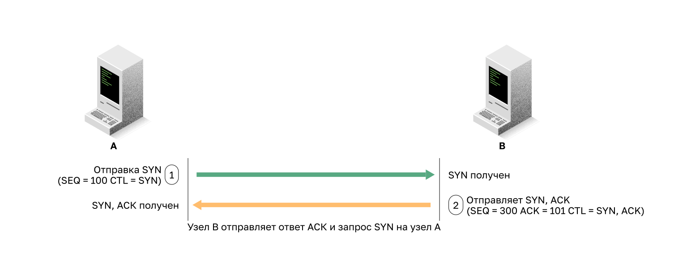

**Шаг 3. ACK** — инициирующий клиент подтверждает сеанс связи «сервер-клиент».

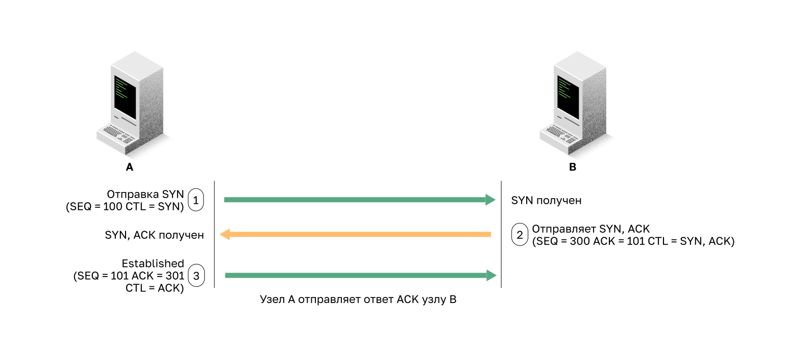

Трехстороннее рукопожатие подтверждает, что узел назначения доступен для связи. В этом примере узел A проверил, что узел B доступен.

<!-- 14.5.3 -->
## Прекращение TCP-соединения

Чтобы прекратить соединение, в заголовке сегмента нужно поставить управляющий флаг Finish (FIN). Для завершения каждого одностороннего TCP-сеанса используется двухстороннее квитирование (рукопожатие, handshake), которое состоит из сегмента FIN и сегмента ACK (подтверждение). Поэтому в общем случае соединение завершается четырьмя сегментами: FIN и ACK в одну сторону, затем FIN и ACK в другую. Если у второй стороны к этому моменту тоже нет данных, она может отправить свой FIN в одном сегменте с подтверждением, и тогда сегментов будет три. Прекращение может инициировать клиент или сервер.

В этом примере термины клиент и сервер используются в качестве ссылки для простоты, но любые два узла, которые имеют открытый сеанс, могут инициировать процесс завершения.

**Шаг 1. FIN** — когда у клиента больше нет данных для отправки в потоке, он отправляет сегмент с установленным флагом FIN.

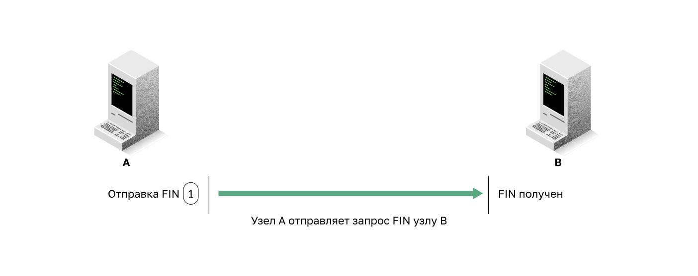

**Шаг 2. ACK** — сервер отправляет подтверждение ACK, чтобы подтвердить получение FIN для завершения сеанса связи «клиент-сервер».

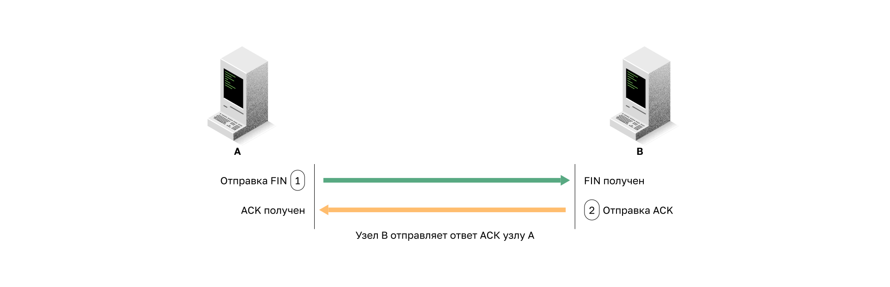

**Шаг 3. FIN** — сервер отправляет клиенту флаг FIN для завершения сеанса связи между сервером и клиентом.

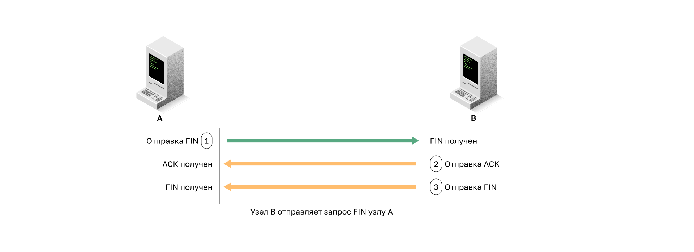

**Шаг 4. ACK** — клиент отправляет в ответ флаг ACK, чтобы подтвердить получение флага FIN от сервера.

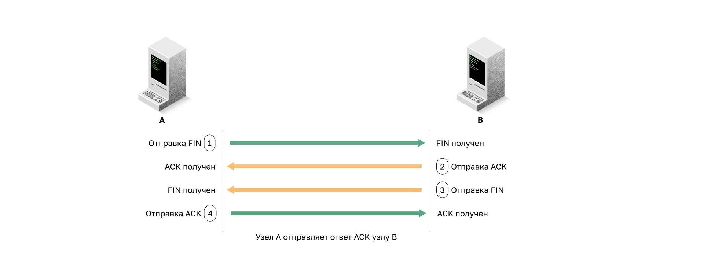

После подтверждения всех сегментов, сеанс закрывается.

<!-- 14.5.4 -->
## Анализ трехстороннего рукопожатия TCP

Узлы отслеживают каждый сегмент данных, передаваемых во время сеанса, и обмениваются полученной информацией с использованием сведений в заголовке TCP. TCP — это полнодуплексный протокол, в котором каждое соединение представляет два односторонних сеанса связи. Чтобы установить соединение, узлы используют трехстороннее рукопожатие. Управляющие биты в заголовке TCP указывают на ход и состояние соединения.

Функции трехстороннего рукопожатия:

* определяет, есть ли в сети устройство назначения;
* проверяет, есть ли на устройстве назначения активная служба и принимает ли она запросы на номер порта назначения, который инициирующий клиент планирует использовать;
* информирует устройство назначения, что клиент источника планирует установить сеанс связи на этом номере порта.

После обмена данными все сеансы закрываются, а соединение прерывается. Механизмы подключения и осуществления сеанса связи включают функции TCP для надежности.

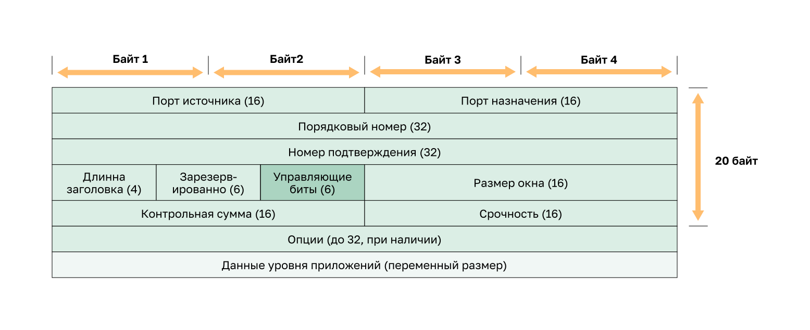

Восемь бит в поле битов управления в заголовке сегмента TCP называются флагами. Каждый флаг представляет собой бит, который либо включен, либо выключен.

Флаги восьми битов управления выглядят следующим образом:

* **CWR** — флаг «Окно перегрузки уменьшено» (Congestion Window Reduced). Отправитель сообщает, что снизил скорость передачи в ответ на уведомление о перегрузке (ECN);
* **ECE** — флаг «Эхо ECN» (ECN-Echo). Получатель сообщает отправителю, что пакет пришел с пометкой о перегрузке в сети (ECN);
* **URG** — флаг «Указатель важности» (Urgent pointer). Устанавливают, если нужно передать ссылку на поле указателя срочности;
* **ACK** — флаг подтверждения. Используют, чтобы установить соединение и завершить сеанс;
* **PSH** — флаг «Push». При нормальном потоке передачи данных система получателя не будет подтверждать получение каждого пакета сразу же после его получения. Вместо этого система получателя в течении некоторого времени будет собирать и хранить полученные данные в буфере, пока не передаст их приложению пользователя. Пакет PUSH инструктирует систему получателя немедленно передать все полученные ранее данные из буфера в приложение пользователя и сразу же отправить сообщение с подтверждением;
* **RST** — Флаг RST. Используют для сброса соединения при ошибке или превышении времени ожидания;
* **SYN** — синхронизирует порядковые номера, используемые при установке соединения;
* **FIN** — больше нет данных от отправителя, используется при завершении сеанса.

<!-- 14.5.5 -->
## Наблюдение за трехэтапным рукопожатием TCP

Обмен сегментами при установлении TCP-соединения можно наблюдать по шагам: в анализаторе пакетов или в режиме симуляции, где каждое событие в сети выполняется отдельно. В примере клиент PC1 (10.1.1.1) запрашивает веб-страницу у сервера Web-Server (192.168.254.254) через маршрутизатор R1.

1. Веб-браузер PC1 открывает адрес http://192.168.254.254. Чтобы получить страницу по протоколу HTTP, клиент сначала устанавливает TCP-соединение с портом 80 сервера, а в качестве порта источника использует динамический порт 49153.
2. В режиме симуляции в списке событий оставлены только TCP и HTTP. Первый сегмент — `TCP SYN 49153 → 192.168.254.254:80`: клиент запрашивает сеанс связи «клиент-сервер». В заголовке TCP установлен флаг SYN, номер последовательности равен 0 — это начальный номер клиента. В реальной сети начальный номер выбирается случайно, а анализаторы пакетов показывают номера относительно него, поэтому и там у сегмента SYN номер 0.
3. Сервер отвечает сегментом `TCP SYN-ACK 80 → 10.1.1.1:49153`. Флаг ACK и номер подтверждения 1 (начальный номер клиента плюс один) подтверждают сеанс «клиент-сервер», а флаг SYN и номер последовательности 0 запрашивают сеанс «сервер-клиент».
4. Клиент отправляет сегмент `TCP ACK 49153 → 192.168.254.254:80` с номером последовательности 1 и номером подтверждения 1 и тем самым подтверждает сеанс «сервер-клиент». Соединение установлено.
5. Сразу после этого клиент отправляет запрос `HTTP GET /` отдельным сегментом TCP, а сервер отвечает `HTTP 200`. В сегментах с данными установлены флаги PSH и ACK.
6. В ответе сервера номер подтверждения равен 42: сервер подтверждает полученные байты запроса GET. Номер подтверждения — следующий номер, который ожидает получатель, поэтому он растет на число полученных байтов.
7. Когда ответ HTTP 200 получен целиком, браузер показывает страницу. Затем соединение прекращается четырьмя сегментами. Сервер отправляет `TCP FIN-ACK 80 → 10.1.1.1:49153`, клиент подтверждает его сегментом ACK и отправляет свой FIN-ACK, а сервер подтверждает FIN клиента последним сегментом ACK. В примере прекращение инициирует сервер.

<!-- 14.5.6 -->
<!-- quiz -->

