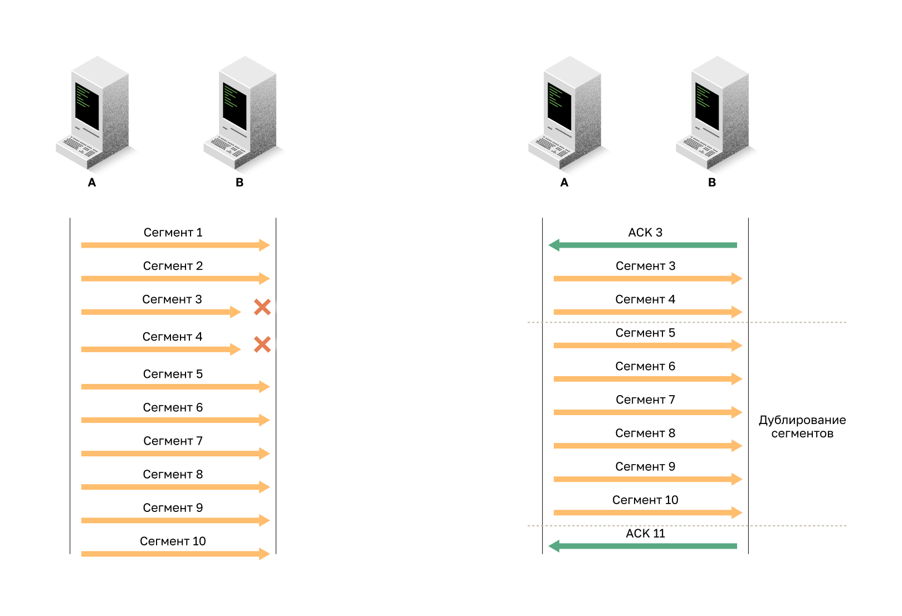
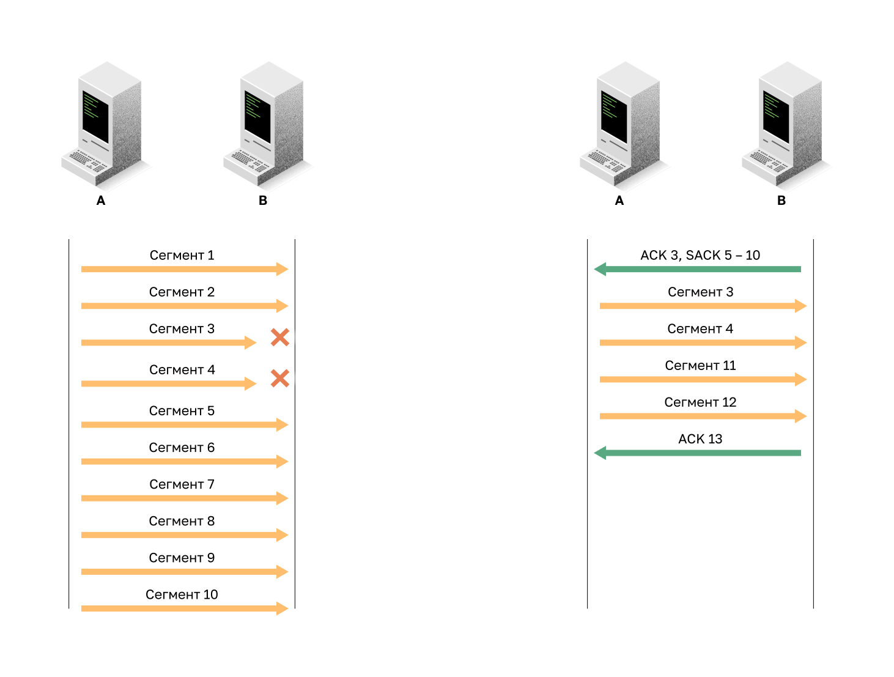
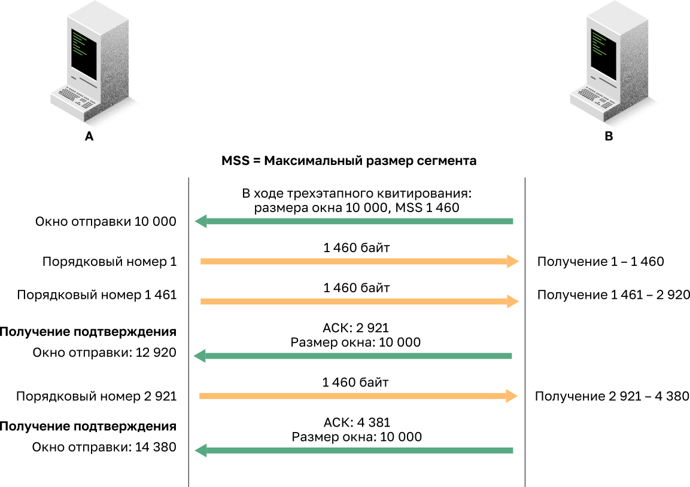
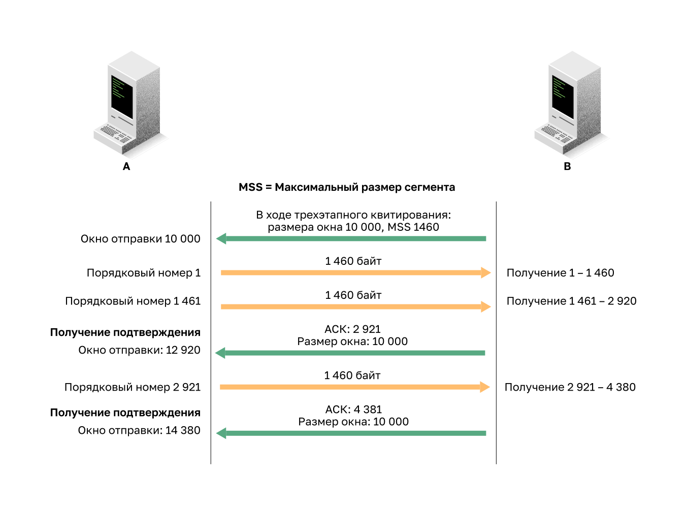
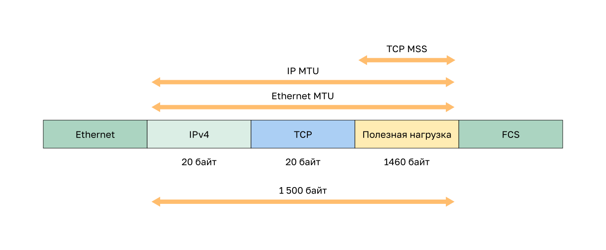
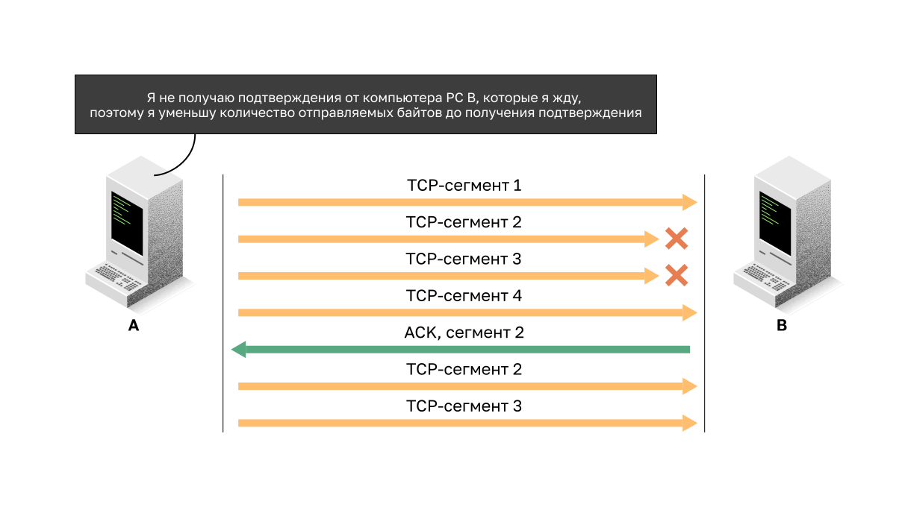

<!-- verified: agorbachev 03.05.2022 -->

<!-- 14.6.1 -->
## Гарантированная и упорядоченная доставка

TCP — лучший протокол для некоторых приложений, потому что, в отличие от UDP, он повторно отправляет отброшенные пакеты и указывает их правильный порядок с помощью нумерации перед доставкой. TCP также поддерживает поток пакетов, чтобы устройства не перегружались. В этом разделе подробно рассматриваются эти особенности.

В некоторых случаях сегменты TCP не приходят к месту назначения. А иногда сегменты TCP поступают в неправильном порядке. Чтобы получатель смог восстановить исходное сообщение, данные в этих сегментах повторно собираются в исходном порядке. Для этого в заголовке каждого сегмента указывается порядковый номер — номер первого байта данных этого сегмента TCP.

Во время настройки сеанса связи задается начальный порядковый номер сеанса (ISN). Он представляет собой стартовое значение счётчика байт, переданных удалённому приложению. По мере передачи данных во время сеанса порядковый номер увеличивается на число переданных байтов. Такое отслеживание позволяет однозначно определять и подтверждать каждый сегмент. Можно выяснить, какие сегменты отсутствуют.

Номер ISN не обязательно должен начинаться с «1», фактически это случайное число. Это позволяет предотвратить определенный тип вредоносных атак. Для удобства в примерах в этой главе в качестве номера ISN используется число 1.

Порядковые номера сегментов указывают порядок повторной сборки. Например, сегменты 1–6 одного сообщения могут пройти по разным маршрутам и прибыть в порядке 1, 2, 6, 5, 4, 3, а TCP на узле назначения по порядковым номерам восстановит исходный порядок 1–6.

Принимающий TCP-процесс помещает данные из сегмента в буфер. Сегменты располагаются в соответствии с порядковыми номерами и после повторной сборки передаются на уровень приложений. Все сегменты, которые поступают с несоответствующими порядковыми номерами, сохраняются для последующей обработки. Затем, когда поступают недостающие сегменты, они обрабатываются по порядку.

<!-- 14.6.2 -->
Одна из функций протокола TCP — гарантированная доставка каждого из сегментов получателю. Службы TCP на узле назначения подтверждают данные, полученные им от приложения источника.

<!-- 14.6.3 -->
## Потеря данных и повторная передача

Иногда данные теряются даже в хорошо разработанной сети. Протокол TCP даёт возможность управлять потерянными сегментами. Для этого есть механизм повторной передачи сегментов с данными, получение которых не было подтверждено.

До усовершенствований TCP мог подтвердить только следующий ожидаемый байт. Например, узел A отправляет на узел B сегменты с 1 по 10. Если прибывают все кроме сегментов 3 и 4, узел B отвечает с подтверждением и указывает, что следующий — сегмент 3. Узел А понятия не имеет, прибыли ли другие сегменты. Таким образом, узел A повторно перешлет сегменты 3-10. Если все они передались успешно, сегменты с 5 по 10 будут дубликатами. Это может привести к задержкам, перегрузкам и неэффективности.

Теперь серверные операционные системы обычно используют выборочное подтверждение (SACK) — опциональную функцию TCP, согласованную во время трехстороннего рукопожатия. Если оба узла поддерживают SACK, принимающее устройство может явно указать, какие сегменты (байты) были получены, в том числе сегменты, полученные после пропуска. Поэтому отправляющий узел повторно передаст только недостающие данные. Например, узел A отправляет сегменты с 1 по 10 на узел B. Если все сегменты прибывают, кроме сегментов 3 и 4, узел B может подтвердить, что он получил сегменты 1 и 2 (ACK 3), и выборочно подтвердить сегменты с 5 по 10 (SACK 5-10). Узел A должен повторно отправить только сегменты 3 и 4.

**Примечание**: TCP обычно отправляет ACK для каждого второго сегмента, но другие факторы, выходящие за рамки данного раздела, могут изменить это поведение.

TCP использует таймеры, чтобы узнать, сколько времени ждать подтверждения перед повторной отправкой сегмента.

<!-- 14.6.4 -->

<!-- 14.6.5 -->
## Управление потоком

Протокол TCP обеспечивает механизмы для управления потоком. Управление потоком ограничивает объем данных, отправляемых без подтверждения, тем объемом, который получатель может принять и надежно обработать. Управление потоком позволяет поддерживать надежность передачи по протоколу TCP, регулируя скорость потока данных между узлами источника и назначения в течение определенного сеанса. Для этого, в заголовке TCP есть 16-битное поле, которое называется размером окна.

Например, во время трехстороннего рукопожатия ПК B сообщает ПК A размер окна 10 000 байт и MSS 1460 байт. ПК A отправляет сегменты по 1460 байт с порядковыми номерами 1, 1461 и 2921, а ПК B подтверждает полученные данные: после подтверждения ACK 2921 с размером окна 10 000 окно отправки ПК A доходит до байта 12 920, а после ACK 4381 — до байта 14 380.

### Размер окна и подтверждения

Размер окна определяет количество байтов, которые могут быть отправлены до ожидания подтверждения. Номер подтверждения — номер следующего ожидаемого байта.

Размер окна — это количество байтов, которое устройство назначения способно принять и обработать за один раз во время сеанса TCP. В этом примере первоначальный размер окна узла PC B для представленного сеанса TCP установлен равным 10 000 байт. Начиная с первого байта (с порядковым номером 1), последним отправленным без подтверждения  будет 10 000-й байт. Это называется окном отправки ПК А. Размер окна включен в каждый сегмент TCP, поэтому получатель может изменить размер окна в любое время в зависимости от доступности буфера.

Каждая сторона сообщает свой размер окна приема уже при установлении сеанса TCP, в сегментах трехстороннего рукопожатия. Согласуется при этом только масштабирование окна (параметр Window Scale): оно включается, если его предлагают обе стороны. Устройство источника должно ограничить количество байтов данных, отправленных устройству назначения, в соответствии с размером окна последнего. Только после получения подтверждения приема байтов устройством источника оно может продолжить отправку остальных данных в этом сеансе. Обычно узел назначения не дожидается получения всех байтов для заданного размера окна, чтобы отправить подтверждение. По мере получения и обработки байтов узел назначения отправляет подтверждения, чтобы сообщить узлу источника о возможности продолжать отправку дополнительных байтов.

Например, ясно, что ПК B не будет ждать, пока все 10000 байтов будут получены, прежде чем отправлять подтверждение. Это означает, что ПК A может настраивать свое окно отправки, когда он получает подтверждения от ПК B. Когда ПК A получает подтверждение с номером следующего ожидаемого байта 2921, окно отправки ПК A увеличится на 2 920 байт. Это изменит окно отправки с 10 000 байт до 12 920. После этого узел PC A может продолжить отправку следующих 10 000 байт на узел PC B, пока на 12 920-м байте не будет достигнуто новое окно отправки.

Отправка подтверждений узлом назначения по мере обработки полученных байтов и непрерывная регулировка окна отправки источника называются скользящими окнами. В предыдущем примере, окно отправки ПК A увеличивается или перемещается на 2 920 байт: с 10 000 до 12 920.

Когда доступное пространство в буфере узла назначения снижается, он может уменьшить размер окна и сообщить узлу источника, сколько байт теперь следует отправлять без получения подтверждения.

**Примечание**: Устройства обычно используют протокол скользящих окон. Получатель обычно отправляет подтверждение после получения каждых 2 сегментов. Количество таких сегментов, после которых отправляется подтверждение, может варьироваться. Преимущество скользящих окон в том, что этот протокол позволяет отправителю передавать сегменты непрерывно, если получатель подтверждает получение предыдущих сегментов. Подробные сведения о скользящих окнах не рассматриваются в этой учебной программе.

<!-- 14.6.6 -->
### Максимальный размер сегмента (MSS)

В этом примере источник передает 1460 байт данных в каждом сегменте. Обычно это максимальный размер сегмента (MSS), который может получить оконечное устройство. MSS — часть поля параметров в заголовке TCP, которая определяет наибольший объем данных в байтах, которые устройство может получить в одном сегменте TCP. Размер MSS не включает заголовок TCP. MSS обычно включается во время трехстороннего рукопожатия.

Обычный MSS составляет 1 460 байт при использовании IPv4. Узел определяет значение своего поля MSS путем вычитания размера заголовков IP и TCP из размера MTU для Ethernet. На интерфейсе Ethernet размер MTU по умолчанию равен 1500 байт. Если вычесть заголовок IPv4 размером 20 байт и заголовок TCP размером 20 байт, то размер MSS по умолчанию будет равен 1460 байт.

<!-- 14.6.7 -->
### Предотвращение перегрузок

Если возникают перегрузки в сети, маршрутизатор перестает обрабатывать пакеты. Когда пакеты с сегментами TCP не доходят до узла назначения, они не подтверждаются. Определив скорость передачи данных, при которой сегменты TCP отправляются, но не подтверждаются, узел источника может примерно определить уровень загруженности сети.

В случае перегрузки потерянных сегментов TCP повторно передают с узла источника. При отсутствии должного контроля над повторной передачей подобная отправка потерянных сегментов TCP может только ухудшить ситуацию. Помимо отправки в сеть новых пакетов с сегментами TCP возникает эффект обратной связи, когда переданные повторно потерянные сегменты TCP еще больше перегружают сеть. Чтобы избежать таких ситуаций и предотвратить перегрузки сети, в протоколе TCP предусмотрены механизмы, таймеры и алгоритмы.

Когда узел источника обнаруживает, что сегменты TCP не подтверждаются своевременно или не подтверждаются вовсе, он может сократить количество байтов, которые он отправляет, прежде чем получит подтверждение. Например, ПК A отправляет сегменты TCP 1–4, сегменты 2 и 3 теряются, и ПК B подтверждением запрашивает сегмент 2, то есть подтверждает только сегмент 1. ПК A повторно отправляет сегменты 2 и 3; не получив ожидаемых подтверждений вовремя, он делает вывод, что в сети перегрузка, и поэтому уменьшает количество байтов, которые он отправляет перед получением подтверждения от ПК B.

Подтверждения нумеруются по следующему полученному байту, а не по номеру сегмента. Номера сегментов упрощены для наглядности.

Следует отметить, что узел источника сокращает именно количество неподтвержденных байтов, которые он отправляет, а не размер окна, определенный узлом назначения.

**Примечание:** Подробные сведения о механизмах, таймерах и алгоритмах, используемых для предотвращения перегрузок, не включены в этот курс.

<!-- 14.6.8 -->
<!-- quiz -->

