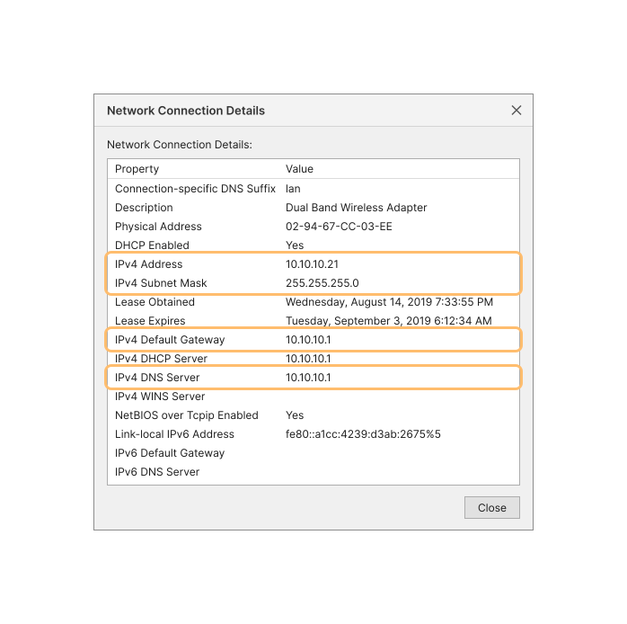
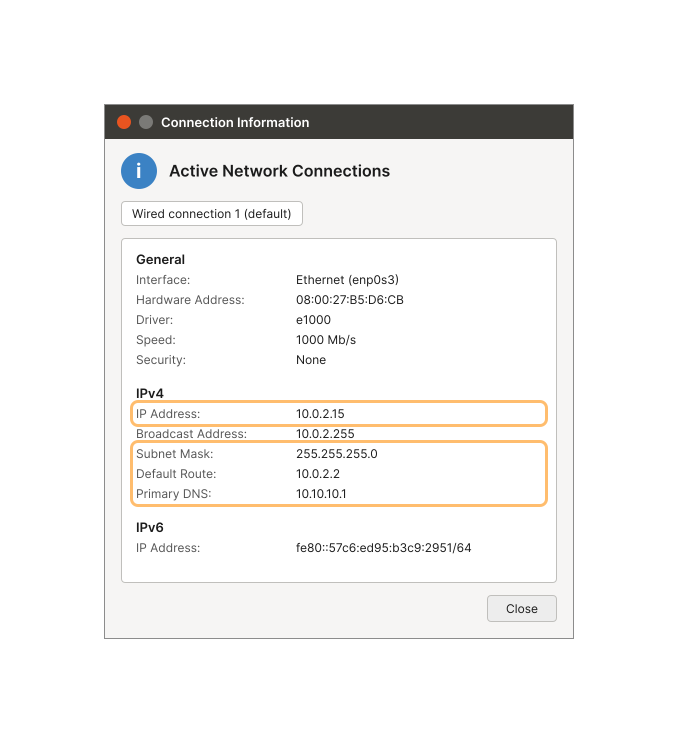
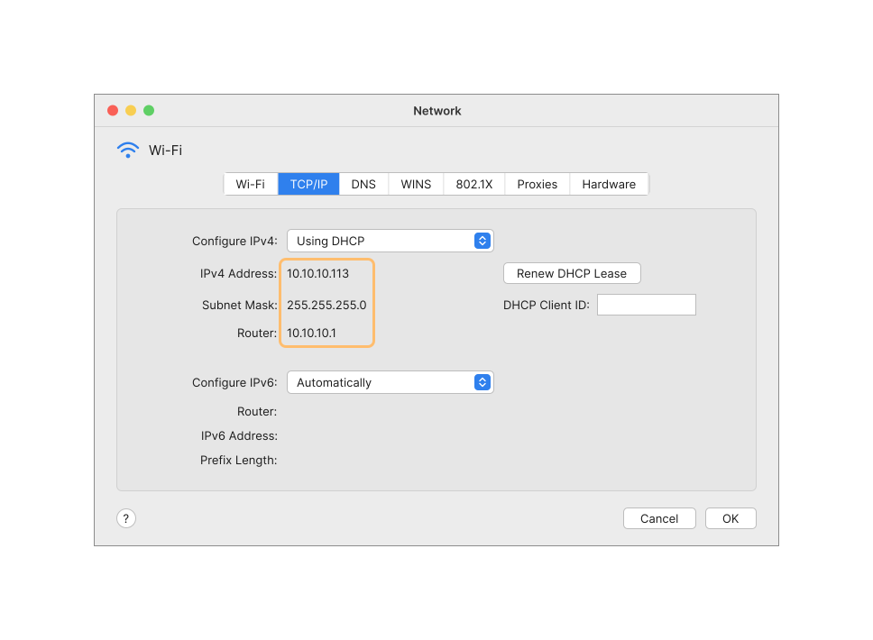

<!-- verified: agorbachev 03.05.2022 -->

<!-- 17.5.1 -->
## Настройка IP-конфигурации в среде Windows

Если вы использовали любое из средств, приведенных в предыдущем разделе, для проверки подключения и обнаружили, что часть сети работает не так, как это должно быть, настало время использовать дополнительные команды для устранения неполадок устройств. Команды ПК и ОС сетевых устройств могут помочь вам определить, связана ли проблема с IP-адресацией ваших устройств, что является распространенной проблемой сети.

Проверка IP-адресации на узлах является обычной практикой в сети для проверки и устранения неполадок сквозного подключения. В Windows 10 можно получить доступ к сведениям об IP-адресе **Network and Sharing Center**, как показано на рисунке, чтобы быстро просмотреть четыре важных параметра: адрес, маска, шлюз и DNS.



Тем не менее, сетевые администраторы обычно просматривают информацию IP-адресации на Windows-устройствах, выполняя команду **ipconfig** в командной строке Windows, как показано в примере.

```
C:\Users\PC-A> ipconfig
Windows IP Configuration
(Output omitted)
Wireless LAN adapter Wi-Fi:
   Connection-specific DNS Suffix  . :
   Link-local IPv6 Address . . . . . : fe80::a4aa:2dd1:ae2d:a75e%16   
   IPv4 Address. . . . . . . . . . . : 192.168.10.10   
   Subnet Mask . . . . . . . . . . . : 255.255.255.0
   Default Gateway . . . . . . . . . : 192.168.10.1
(Output omitted)
```

С помощью команды **ipconfig /all** можно узнать MAC-адрес компьютера, а также ряд сведений об адресации уровня 3 для устройства, как показано в примере.

```
C:\Users\PC-A> ipconfig /all
Windows IP Configuration
   Host Name . . . . . . . . . . . . : PC-A-00H20
   Primary Dns Suffix  . . . . . . . : nsalab.local
   Node Type . . . . . . . . . . . . : Hybrid
   IP Routing Enabled. . . . . . . . : No
   WINS Proxy Enabled. . . . . . . . : No
   DNS Suffix Search List. . . . . . : nsalab.local
(Output omitted)
Wireless LAN adapter Wi-Fi:
   Connection-specific DNS Suffix  . :
   Description . . . . . . . . . . . : Intel(R) Dual Band Wireless-AC 8265
   Physical Address. . . . . . . . . : F8-94-C2-E4-C5-0A
   DHCP Enabled. . . . . . . . . . . : Yes
   Autoconfiguration Enabled . . . . : Yes
   Link-local IPv6 Address . . . . . : fe80::a4aa:2dd1:ae2d:a75e%16(Preferred) 
   IPv4 Address. . . . . . . . . . . : 192.168.10.10(Preferred)
   Subnet Mask . . . . . . . . . . . : 255.255.255.0
   Lease Obtained. . . . . . . . . . : August 17, 2019 1:20:17 PM
   Lease Expires . . . . . . . . . . : August 18, 2019 1:20:18 PM
   Default Gateway . . . . . . . . . : 192.168.10.1
   DHCP Server . . . . . . . . . . . : 192.168.10.1
   DHCPv6 IAID . . . . . . . . . . . : 100177090
   DHCPv6 Client DUID. . . . . . . . : 00-01-00-01-21-F3-76-75-54-E1-AD-DE-DA-9A
   DNS Servers . . . . . . . . . . . : 192.168.10.1
   NetBIOS over Tcpip. . . . . . . . : Enabled
```

Если узел настроен как DHCP-клиент, конфигурацию IP-адреса можно обновить с помощью команды **ipconfig /release** и **ipconfig /renew**, как показано в примере.

```
C:\Users\PC-A> ipconfig /release
(Output omitted)
Wireless LAN adapter Wi-Fi:
   Connection-specific DNS Suffix  . :
   Link-local IPv6 Address . . . . . : fe80::a4aa:2dd1:ae2d:a75e%16
   Default Gateway . . . . . . . . . :
(Output omitted)
C:\Users\PC-A> ipconfig /renew
(Output omitted)
Wireless LAN adapter Wi-Fi:
   Connection-specific DNS Suffix  . :
   Link-local IPv6 Address . . . . . : fe80::a4aa:2dd1:ae2d:a75e%16
   IPv4 Address. . . . . . . . . . . : 192.168.1.124
   Subnet Mask . . . . . . . . . . . : 255.255.255.0
   Default Gateway . . . . . . . . . : 192.168.1.1
(Output omitted)
C:\Users\PC-A>
```

Служба «Клиент DNS» на ПК с операционной системой Windows также оптимизирует производительность разрешения имен DNS, сохраняя ранее разрешенные имена в памяти. На ПК с операционной системой Windows команда **ipconfig /displaydns** выводит на экран все кэшированные записи DNS.

```
C:\Users\PC-A> ipconfig /displaydns
Windows IP Configuration
(Output omitted)
    netacad.com
    ----------------------------------------
    Record Name . . . . . : netacad.com
    Record Type . . . . . : 1
    Time To Live  . . . . : 602
    Data Length . . . . . : 4
    Section . . . . . . . : Answer
    A (Host) Record . . . : 54.165.95.219
(Output omitted)
```

<!-- 17.5.2 -->
## Настройка IP-конфигурации в среде Linux

Проверка параметров IP с помощью графического интерфейса на компьютере Linux будет отличаться в зависимости от дистрибутива Linux и интерфейса рабочего стола. На рисунке показано диалоговое окно **Connection Information** в дистрибутиве Ubuntu под управлением рабочего стола Gnome.



В командной строке сетевые администраторы используют команду **ifconfig** для отображения состояния активных интерфейсов и их IP-конфигурации, как показано в примере.

```
[analyst@secOps ~]$ ifconfig
enp0s3    Link encap:Ethernet  HWaddr 08:00:27:b5:d6:cb  
          inet addr: 10.0.2.15  Bcast:10.0.2.255  Mask: 255.255.255.0
          inet6 addr: fe80::57c6:ed95:b3c9:2951/64 Scope:Link
          UP BROADCAST RUNNING MULTICAST  MTU:1500  Metric:1
          RX packets:1332239 errors:0 dropped:0 overruns:0 frame:0
          TX packets:105910 errors:0 dropped:0 overruns:0 carrier:0
          collisions:0 txqueuelen:1000 
          RX bytes:1855455014 (1.8 GB)  TX bytes:13140139 (13.1 MB)
lo: flags=73  mtu 65536
        inet 127.0.0.1  netmask 255.0.0.0
        inet6 ::1  prefixlen 128  scopeid 0x10<host>
        loop  txqueuelen 1000  (Local Loopback)
        RX packets 0  bytes 0 (0.0 B)
        RX errors 0  dropped 0  overruns 0  frame 0
        TX packets 0  bytes 0 (0.0 B)
        TX errors 0  dropped 0 overruns 0  carrier 0  collisions 0
```

В Linux команда **ip address** используется для отображения адресов и их свойств. Она также может использоваться для добавления или удаления IP-адресов.

**Примечание.** Вывод может варьироваться в зависимости от дистрибутива Linux .

<!-- 17.5.3 -->
## Настройка IP-конфигурации в среде MacOS 

В графическом интерфейсе узла Mac откройте меню **Network Preferences > Advanced** для получения информации об IP-адресации, как показано на рисунке.



Однако команда **ifconfig** также может использоваться для проверки конфигурации интерфейса IP, показанной в выводе.

```
MacBook-Air:~ Admin$ ifconfig en0
en0: flags=8863 mtu 1500
        ether c4:b3:01:a0:64:98
        inet6 fe80::c0f:1bf4:60b1:3adb%en0 prefixlen 64 secured scopeid 0x5
        inet 10.10.10.113 netmask 0xffffff00 broadcast 10.10.10.255
        nd6 options=201
        media: autoselect
        status: active
MacBook-Air:~ Admin$ 
```

Другие полезные команды macOS для проверки параметров IP узла включают **networksetup -listallnetworkservices** и **networksetup -getinfo <**_network service_**\>,** как показано в следующих выходных данных. 

```
MacBook-Air:~ Admin$ networksetup -listallnetworkservices
An asterisk (*) denotes that a network service is disabled.
iPhone USB
Wi-Fi
Bluetooth PAN
Thunderbolt Bridge
MacBook-Air:~ Admin$ 
MacBook-Air:~ Admin$ networksetup -getinfo Wi-Fi
DHCP Configuration
IP address: 10.10.10.113
Subnet mask: 255.255.255.0
Router: 10.10.10.1
Client ID:
IPv6: Automatic
IPv6 IP address: none
IPv6 Router: none
Wi-Fi ID: c4:b3:01:a0:64:98
MacBook-Air:~ Admin$
```

<!-- 17.5.4 -->
## Команда arp

 Команда **arp** выполняется из командной строки Windows, Linux или Mac. Команда **arp –a** позволяет получить список всех устройств, которые в данный момент представлены в ARP-кэше узла, а также IPv4-адрес, физический адрес и тип адресации (статическая/динамическая) для каждого из устройств.

Например, обратимся к следующей топологии.


Вывод команды **arp -a** на узле Windows PC-A. 

```
C:\Users\PC-A> arp -a
Interface: 192.168.93.175 --- 0xc
  Internet Address      Physical Address      Type
  10.0.0.2              d0-67-e5-b6-56-4b     dynamic
  10.0.0.3              78-48-59-e3-b4-01     dynamic
  10.0.0.4              00-21-b6-00-16-97     dynamic
  10.0.0.254            00-15-99-cd-38-d9     dynamic
  
```

Команда **arp -a** отображает связку известных IP-адресов и MAC-адресов. Обратите внимание, что IP-адрес 10.0.0.5 не включен в список. Это связано с тем, что кэш ARP отображает информацию только с устройств, к которым недавно обращались.

Чтобы проверить заполнение кэша ARP, выполните команду **ping** для проверки связи с устройством, чтобы для него была создана запись в таблице ARP. Например, если PC-A посылает запрос 10.0.0.5, то кэш ARP будет содержать запись для этого IP-адреса.

Если администратору сети необходимо повторно заполнить кэш обновленными данными, можно выполнить команду **netsh interface ip delete arpcache** для очистки кэша.

**Примечание.** Для использования команды **netsh interface ip delete arpcache** может потребоваться доступ администратора на узле.

<!-- 17.5.5 -->
## Команды ОС для просмотра текущей информации

С помощью команд можно проверять настройки интерфейсов промежуточных устройств по аналогии с тем, как команды и утилиты использовались на узлах для проверки их настроек. В ОС имеются команды для проверки работоспособности интерфейсов маршрутизатора и коммутатора.

Интерфейс командной строки ОС позволяет пользоваться командами **show** для отображения информации о конфигурации и режиме работы устройства. Специалисты по обслуживанию сети широко пользуются командами **show** для просмотра файлов конфигурации, проверки состояния интерфейсов и процессов на устройствах, а также для контроля рабочего состояния устройств. С помощью команды **show** можно отобразить состояние практически любого процесса или функции маршрутизатора.

В таблице перечислены часто используемые **show** команды и время их использования.

| Команда | **Для чего используется** |
| --- | --- |
| **show running-config**  | Проверяет текущую конфигурацию и параметры |
| **show interfaces** | Проверяет состояние интерфейса и отображает все сообщения об ошибках |
| **show ip interface** | Проверяет информацию 3 уровня  интерфейса |
| **show arp** | Проверяет список известных узлов в локальных сетях Ethernet |
| **show ip route**  | Проверяет информацию маршрутизации уровня 3 |
| **show protocols**  | Проверяет, какие протоколы работают |
| **show version**  | Показывает версию ОС, файл образа, время работы, объем памяти и интерфейсы устройства |

### Команда show running-config 

Проверяет текущую конфигурацию и параметры

```
R1# show running-config

(Output omitted)

!
version 15.5
service timestamps debug datetime msec
service timestamps log datetime msec
service password-encryption
!
hostname R1
!
interface GigabitEthernet0/0/0
 description Link to R2
 ip address 209.165.200.225 255.255.255.252
 negotiation auto
!
interface GigabitEthernet0/0/1
 description Link to LAN
 ip address 192.168.10.1 255.255.255.0
 negotiation auto
!
router ospf 10
 network 192.168.10.0 0.0.0.255 area 0
 network 209.165.200.224 0.0.0.3 area 0
!
banner motd ^C Authorized access only! ^C
!
line con 0
 password 7 1419171F000528
 login
line vty 0 4
 password 7 000A1612085A09
 login
 transport input telnet ssh
!
end
R1#
```

### Команда show interfaces

Проверяет состояние интерфейса и отображает все сообщения об ошибках

```
R1#show interfaces
GigabitEthernet0/0/0 is up, line protocol is up
  Hardware is Gigabit Ethernet, address is 00d0.e72c.7a01 (bia 00d0.e72c.7a01)
  Description: Link to R2
  Internet address is 209.165.200.225/30
  MTU 1500 bytes, BW 1000000 Kbit/sec, DLY 10 usec,
     reliability 255/255, txload 1/255, rxload 1/255
  Encapsulation ARPA, loopback not set
  Keepalive set (10 sec)
  Full Duplex, 1Gbps, media type is RJ45
  output flow-control is unsupported, input flow-control is unsupported
  ARP type: ARPA, ARP Timeout 04:00:00
  Last input never, output never, output hang never
  Last clearing of "show interface" counters never
  Input queue: 0/75/0/0 (size/max/drops/flushes); Total output drops: 0
  Queueing strategy: fifo
  Output queue: 0/40 (size/max)
  5 minute input rate 0 bits/sec, 0 packets/sec
  5 minute output rate 0 bits/sec, 0 packets/sec
     0 packets input, 0 bytes, 0 no buffer
     Received 0 broadcasts (0 IP multicasts)
     0 runts, 0 giants, 0 throttles
     0 input errors, 0 CRC, 0 frame, 0 overrun, 0 ignored
     0 watchdog, 0 multicast, 0 pause input
     0 packets output, 0 bytes, 0 underruns
     0 output errors, 0 collisions, 0 interface resets
     0 unknown protocol drops
     0 babbles, 0 late collision, 0 deferred
     0 lost carrier, 0 no carrier, 0 pause output
     0 output buffer failures, 0 output buffers swapped out
GigabitEthernet0/0/1 is up, line protocol is up
(Output omitted)
```

### Команда show ip interface

Проверяет информацию уровня 3 интерфейса

```
R1# show ip interface
GigabitEthernet0/0/0 is up, line protocol is up
  Internet address is 209.165.200.225/30
  Broadcast address is 255.255.255.255
  Address determined by setup command
  MTU is 1500 bytes
  Helper address is not set
  Directed broadcast forwarding is disabled
  Multicast reserved groups joined: 224.0.0.5 224.0.0.6
  Outgoing Common access list is not set
  Outgoing access list is not set
  Inbound Common access list is not set
  Inbound  access list is not set
  Proxy ARP is enabled
  Local Proxy ARP is disabled
  Security level is default
  Split horizon is enabled
  ICMP redirects are always sent
  ICMP unreachables are always sent
  ICMP mask replies are never sent
  IP fast switching is enabled
  IP Flow switching is disabled
  IP CEF switching is enabled
  IP CEF switching turbo vector
  IP Null turbo vector
  Associated unicast routing topologies:
        Topology "base", operation state is UP
  IP multicast fast switching is enabled
  IP multicast distributed fast switching is disabled
  IP route-cache flags are Fast, CEF
  Router Discovery is disabled
  IP output packet accounting is disabled
  IP access violation accounting is disabled
  TCP/IP header compression is disabled
  RTP/IP header compression is disabled
  Probe proxy name replies are disabled
  Policy routing is disabled
  Network address translation is disabled
  BGP Policy Mapping is disabled
  Input features: MCI Check
  IPv4 WCCP Redirect outbound is disabled
  IPv4 WCCP Redirect inbound is disabled
  IPv4 WCCP Redirect exclude is disabled
GigabitEthernet0/0/1 is up, line protocol is up
(Output omitted)
```

### Команда show arp

Проверяет список известных узлов в локальных сетях Ethernet

```
R1# show arp
Protocol  Address          Age (min)  Hardware Addr   Type   Interface
Internet  192.168.10.1            -   a0e0.af0d.e141  ARPA   GigabitEthernet0/0/1
Internet  192.168.10.10          95   c07b.bcc4.a9c0  ARPA   GigabitEthernet0/0/1
Internet  209.165.200.225         -   a0e0.af0d.e140  ARPA   GigabitEthernet0/0/0
Internet  209.165.200.226       138   a03d.6fe1.9d90  ARPA   GigabitEthernet0/0/0
R1#
```

### Команда show ip route 

Проверяет информацию маршрутизации уровня 3

```
R1# show ip route
Codes: L - local, C - connected, S - static, R - RIP, M - mobile, B - BGP
       D - EIGRP, EX - EIGRP external, O - OSPF, IA - OSPF inter area
       N1 - OSPF NSSA external type 1, N2 - OSPF NSSA external type 2
       E1 - OSPF external type 1, E2 - OSPF external type 2
       i - IS-IS, su - IS-IS summary, L1 - IS-IS level-1, L2 - IS-IS level-2
       ia - IS-IS inter area, * - candidate default, U - per-user static route
       o - ODR, P - periodic downloaded static route, H - NHRP, l - LISP
       a - application route
       + - replicated route, % - next hop override, p - overrides from PfR
Gateway of last resort is 209.165.200.226 to network 0.0.0.0
O*E2  0.0.0.0/0 [110/1] via 209.165.200.226, 02:19:50, GigabitEthernet0/0/0
      10.0.0.0/24 is subnetted, 1 subnets
O        10.1.1.0 [110/3] via 209.165.200.226, 02:05:42, GigabitEthernet0/0/0
      192.168.10.0/24 is variably subnetted, 2 subnets, 2 masks
C        192.168.10.0/24 is directly connected, GigabitEthernet0/0/1
L        192.168.10.1/32 is directly connected, GigabitEthernet0/0/1
      209.165.200.0/24 is variably subnetted, 3 subnets, 2 masks
C        209.165.200.224/30 is directly connected, GigabitEthernet0/0/0
L        209.165.200.225/32 is directly connected, GigabitEthernet0/0/0
O        209.165.200.228/30
           [110/2] via 209.165.200.226, 02:07:19, GigabitEthernet0/0/0
R1#
```

### Команда show protocols

Проверяет, какие протоколы работают

```
R1# show protocols
Global values:
  Internet Protocol routing is enabled
GigabitEthernet0/0/0 is up, line protocol is up
  Internet address is 209.165.200.225/30
GigabitEthernet0/0/1 is up, line protocol is up
  Internet address is 192.168.10.1/24
Serial0/1/0 is down, line protocol is down
Serial0/1/1 is down, line protocol is down
GigabitEthernet0 is administratively down, line protocol is down
R1#
```

### Команда show version

Показывает версию ОС, файл образа, время работы, объем памяти и интерфейсы устройства

```
R1#show version
NSALAB NetOS Software, NR05 Software (NR05-NETOS-M), Version 0.1.0, RELEASE SOFTWARE
Copyright (c) 2026 NSALAB

R1 uptime is 1 minute
System returned to ROM by power-on
System image file is "flash0:nr05-netos-0.1.0.bin"

NSALAB NR05 (revision 1.0) with 1048576K/6147K bytes of memory.
Processor board ID NSA00000001
2 Gigabit Ethernet interfaces
2 Serial(sync/async) interfaces
256K bytes of non-volatile configuration memory.

Configuration register is 0x2102
R1#
```

<!-- 17.5.6 -->
## Команда show cdp neighbors

Несколько других полезных команд ОС. Протокол **CDP** — проприетарный протокол, функционирующий на канальном уровне. Поскольку протокол CDP функционирует на канальном уровне, два (или более) сетевых устройства, такие как маршрутизаторы с поддержкой различных протоколов сетевого уровня, могут получить данные друг о друге даже в том случае, если соединения третьего уровня не существует.

На устройствах, которые поддерживают CDP, протокол запускается по умолчанию во время загрузки. Протокол CDP автоматически обнаруживает соседние устройства, на которых он запущен, независимо от работающих протоколов третьего уровня и пакетов. Протокол CDP осуществляет обмен данными о программном и аппаратном обеспечении устройства с непосредственно подключенными соседними устройствами CDP.

Протокол CDP предоставляет следующие сведения о каждом из соседних устройств CDP.

* **Идентификаторы устройств** — настроенное имя узла коммутатора, маршрутизатора или другого устройства.
* **Список адресов** — не более одного адреса сетевого уровня для каждого из поддерживаемых протоколов.
* **Идентификатор порта** — имя локального и удаленного порта в виде строки символов ASCII (например, FastEthernet 0/0).
* **Список возможностей** — например, является ли конкретное устройство коммутатором второго или третьего уровня.
* **Платформа** — аппаратная платформа устройства, например модель маршрутизатора.


```
R3#show cdp neighbors
Capability Codes: R - Router, T - Trans Bridge, B - Source Route Bridge
                  S - Switch, H - Host, I - IGMP, r - Repeater, P - Phone,
                  D - Remote, C - CVTA, M - Two-port Mac Relay

Device ID        Local Intrfce     Holdtme    Capability  Platform  Port ID
S3               Gig 0/0/1         150                S I NS01      Fas 0/5

Total cdp entries displayed : 1
R3#
```

Выходные данные показывают, что интерфейс R3 GigabitEthernet 0/0/1 подключен к интерфейсу FastEthernet 0/5 S3, который является коммутатором. Обратите внимание, что R3 не собрал информацию о S4. Это связано с тем, что CDP может обнаруживать только напрямую подключенные устройства. S4 напрямую не подключен к R3 и поэтому не указан в выводе.

Команда **show cdp neighbors detail** показывает IP-адрес соседнего устройства, как показано на выводе. Протокол CDP отображает IP-адрес соседнего устройства независимо от того, насколько успешно удается выполнить проверку связи с ним. Эту команду рекомендуется использовать, когда двум маршрутизаторам не удается выполнить маршрутизацию по общему каналу данных. Команда **show cdp neighbors detail** позволяет определить наличие ошибок конфигурации IP в любом из соседних устройств CDP.

Несмотря на свою полезность, CDP также может быть угрозой безопасности, поскольку он может предоставлять злоумышленникам важные данные сетевой инфраструктуры. Например, по умолчанию многие версии ОС посылают объявления CDP на все поддерживаемые порты. Рекомендуется включать CDP только на интерфейсах, соединенных с другими устройствами инфраструктуры. Объявления CDP должны быть отключены на портах, ориентированных на пользователей.

Поскольку некоторые версии ОС по умолчанию рассылают анонсы CDP, важно знать, как отключить этот протокол. Чтобы сделать это на глобальном уровне, используйте команду глобальной конфигурации **no cdp run**. Чтобы сделать это на уровне интерфейса, используйте команду интерфейса **no cdp enable**.

### Протокол LLDP

CDP — проприетарный протокол, и его поддерживают не все устройства. Стандартный протокол с той же задачей — протокол обнаружения канального уровня (Link Layer Discovery Protocol, **LLDP**), описанный в стандарте IEEE 802.1AB. Его поддерживают сетевые устройства разных производителей, а также многие серверы, IP-телефоны и беспроводные точки доступа. Как и CDP, протокол LLDP функционирует на канальном уровне, поэтому соседние устройства получают данные друг о друге даже в том случае, если соединения третьего уровня не существует.

Устройство с включенным протоколом LLDP периодически рассылает объявления через свои интерфейсы. Из объявлений соседних устройств LLDP получает следующие сведения.

* **Идентификаторы шасси и порта** — обязательные поля, по которым однозначно определяются соседнее устройство и его интерфейс.
* **Имя системы** — настроенное имя узла соседнего устройства.
* **Описание порта и описание системы** — сведения об интерфейсе, программном и аппаратном обеспечении соседнего устройства.
* **Список возможностей** — например, является ли устройство маршрутизатором, коммутатором или телефоном.
* **Адрес управления** — IP-адрес, по которому можно подключиться к соседнему устройству.

В отличие от CDP, во многих ОС сетевых устройств протокол LLDP по умолчанию отключен. Чтобы включить его на глобальном уровне, используйте команду глобальной конфигурации **lldp run**, а чтобы отключить — **no lldp run**. На отдельном интерфейсе можно запретить только отправку или только прием объявлений командами интерфейса **no lldp transmit** и **no lldp receive**.

Команда **show lldp neighbors** выводит список соседних устройств, обнаруженных с помощью LLDP: имя соседнего устройства, локальный интерфейс, к которому оно подключено, время хранения записи, список возможностей и идентификатор порта соседнего устройства. Команда **show lldp neighbors detail** дополнительно показывает адрес управления и описание системы каждого соседнего устройства, поэтому, как и **show cdp neighbors detail**, помогает найти ошибки конфигурации IP у соседних устройств.

<!-- LLDP: пример вывода show lldp neighbors вставить, когда его можно будет получить в симуляторе (kb#272) -->

Протокол LLDP несет те же риски, что и CDP: его объявления раскрывают сведения о сетевой инфраструктуре. Поэтому включайте LLDP только на интерфейсах, соединенных с другими устройствами инфраструктуры, и отключайте его отправку на портах, ориентированных на пользователей.

<!-- 17.5.7 -->
## Команда show ip interface brief

К наиболее часто используемым командам относится команда **show ip interface brief**. Эта команда выводит выходные данные в более компактном формате, чем команда **show ip interface**. Она предоставляет сводку по ключевым данным для всех сетевых интерфейсов на маршрутизаторе.

В результатах выполнения команды **show ip interface brief** отображаются все интерфейсы на маршрутизаторе, IP-адрес, назначенный для каждого из интерфейсов (если есть), и рабочее состояние интерфейса.

```
R1# show ip interface brief
Interface              IP-Address      OK? Method Status                Protocol
GigabitEthernet0/0/0   209.165.200.225 YES manual up                    up
GigabitEthernet0/0/1   192.168.10.1    YES manual up                    up
Serial0/1/0            unassigned      NO  unset  down                  down
Serial0/1/1            unassigned      NO  unset  down                  down
GigabitEthernet0       unassigned      YES unset  administratively down down
R1#
```

Команду **show ip interface brief** также можно использовать для проверки статуса интерфейсов коммутатора.

```
S1# show ip interface brief
Interface              IP-Address      OK? Method Status                Protocol
Vlan1                  192.168.254.250 YES manual up                    up
FastEthernet0/1        unassigned      YES unset  down                  down
FastEthernet0/2        unassigned      YES unset  up                    up
FastEthernet0/3        unassigned      YES unset  up                    up
```

Интерфейсу VLAN1 назначен IPv4-адрес 192.168.254.250, он включен и работает.

В результатах выполнения команды также указано, что интерфейс FastEthernet0/1 отключен. Это означает, что к интерфейсу не подключены устройства или сетевой интерфейс подключенного устройства не работает.

И наоборот, в результатах выполнения команды указано, что интерфейсы FastEthernet0/2 и FastEthernet0/3 работают. Это обозначено состоянием **up** в столбцах **Status** (состояние) и **Protocol** (протокол).

<!-- 17.5.8 -->
## Видео: использование команды show version

Команду **show version** можно применять для проверки и устранения неполадок базовых программных и аппаратных компонентов, которые используются во время загрузки. Посмотрите видео, представленное ранее в этом курсе, посвященное команде **show version**.


